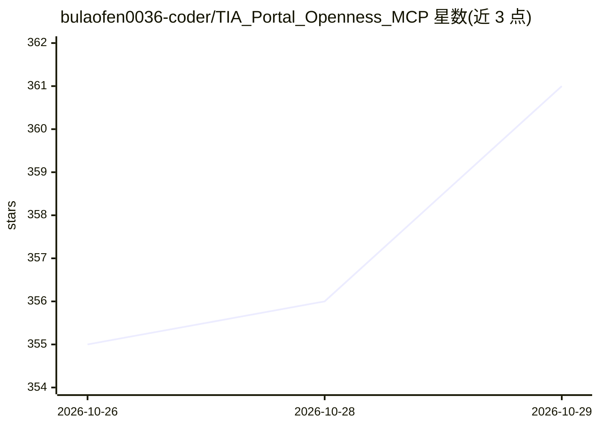

# bulaofen0036-coder/TIA_Portal_Openness_MCP

⭐ 361 · C# · MIT · 推送 2026-10-26 · [GitHub](https://github.com/bulaofen0036-coder/TIA_Portal_Openness_MCP) · [官网](https://aeenhance.com) · 个人维护 · 中文 README

**通过 MCP/CLI 驱动西门子 TIA Portal 的工业自动化工具服务**

面向工业自动化工程师的 MCP 服务器与 CLI（同一 exe）：让任意 MCP 客户端（Cursor、Claude Desktop、VS Code 等）或纯命令行驱动 TIA Portal V20/V21，实现创建工程、添加硬件、生成 PLC 对象（Tag/UDT/DB/SCL/LAD）、构建 WinCC Unified 画面、编译诊断与保存，共 235 个分层工具。附带预编译运行时、模板与一键配置脚本（自动写入各 AI 客户端的 MCP 配置）。另支持将 TIA 工程映射为文本文件纳入 Git 版本控制。需 Windows、.NET Framework 4.8 与已安装的 TIA Portal，用户须加入 Siemens TIA Openness 用户组。作者另发商业桌面版 TIA 助手（同引擎，内置 AI 助手）。

## 筛选速览

| 维度 | 判定 | 备注 |
|---|---|---|
| AI 角色 | `ai-ecosystem` | LLM/agent 周边工具 |
| 许可风险 | `permissive` | MIT |
| 部署形态 | `desktop` | 安装包/桌面程序 |
| 模型依赖 | — | README 未给出锁定关系 |
| 硬件要求 | — | 无带数字的原话,不猜 |
| 安装摩擦 | `medium` | 含编译或系统依赖之一 |
| 成熟度 | — | 结构信号不足 |

## 能力要点

- 同一 exe 兼作 MCP 服务器与声明式 CLI（gen/patch/compile 等 9 个动词）
- 235 个分层工具（L0/L1/L2），默认仅列出 65 个核心工具以控制上下文占用
- V20/V21 双版本独立 exe，导入 XML 自动归一化到所连门户版本
- 基于 V21 Version Control Interface 将 TIA 工程映射为每块一文本文件，可 git diff/commit

## 适用场景

- 让 Cursor/Claude 等 AI 客户端按自然语言生成 PLC 与 HMI 工程
- 不用 MCP 客户端，用 tia gen 一条命令由 YAML/JSON 规格生成工程
- 把二进制 TIA 工程纳入 Git 做块级变更追踪与评审

## 场景标签

`代码生成` · 领域:编码与开发

## 证据(README 行号)

> L25: Drive **Siemens TIA Portal V20 or V21** from any **MCP** client (stdio or HTTP):
> L33: > Works with any MCP-capable client — Cursor, VS Code, Claude Desktop, or your

## 星数曲线

2026-10-26 355 → 2026-10-29 361（+6）

---
*卡片 v1 · prompt 1.4 · 生成 2026-10-27 · 置信度 high · 依据 README sha `1b67cc8aab76` · [字段定义](../../DATASET.md)*
