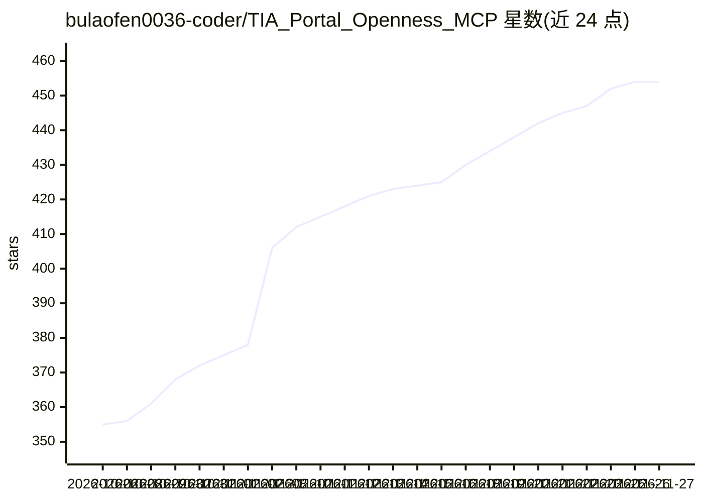

# bulaofen0036-coder/TIA_Portal_Openness_MCP

⭐ 454 · C# · MIT · 推送 2026-11-14 · [GitHub](https://github.com/bulaofen0036-coder/TIA_Portal_Openness_MCP) · [官网](https://aeenhance.com) · 个人维护 · 中文 README

**让 AI 客户端经 MCP 驱动西门子 TIA Portal 的服务器与 CLI**

面向工业自动化工程师的 MCP 服务器：通过 MCP 客户端（stdio/HTTP）以自然语言工具调用创建 TIA Portal V20/V21 工程、添加硬件、生成 PLC 对象（Tag/UDT/DB/SCL/LAD）与 WinCC Unified 画面、编译诊断并保存。附带 `tia` 命令行，AI 生成 YAML/JSON 规格后一键生成工程，无需 MCP 客户端。提供预编译运行时、doctor 环境检查、VCI 版本控制（项目映射为文本文件供 Git diff）与只读在线监控。需 Windows + TIA Portal + .NET Framework 4.8。

## 筛选速览

| 维度 | 判定 | 备注 |
|---|---|---|
| AI 角色 | `ai-ecosystem` | LLM/agent 周边工具 |
| 许可风险 | `permissive` | MIT |
| 部署形态 | `desktop` | 安装包/桌面程序 |
| 模型依赖 | — | README 未给出锁定关系 |
| 硬件要求 | — | 无带数字的原话,不猜 |
| 安装摩擦 | `medium` | 含编译或系统依赖之一 |
| 成熟度 | — | 结构信号不足 |

## 能力要点

- 235 个工具覆盖项目/硬件/PLC/HMI/在线操作，分层 L0/L1/L2
- 同一 exe 兼作声明式 CLI（gen/patch/compile/describe 等）
- VCI 将二进制工程映射为每块一文件的文本，支持 Git diff 与提交
- doctor 一键环境检查并给出逐项修复；预编译运行时免编码

## 适用场景

- 用自然语言生成 S7-1200/1500 的 PLC 与 HMI 工程并编译诊断
- 把 TIA Portal 工程纳入 Git 做逐块差异审阅
- 通过 MCP 客户端（Cursor/Claude Desktop/VS Code）操作 TIA Portal
- 只读在线监控 PLC 数值并导出趋势 CSV

## 场景标签

`代码生成` · 领域:编码与开发

## 证据(README 行号)

> L25: Drive **Siemens TIA Portal V20 or V21** from any **MCP** client (stdio or HTTP):
> L118: |AI|Bring your own (Cursor / Claude Desktop / VS Code …)|**Built-in AI assistant**; DeepSeek, Qwen, Kimi, Zhipu or
> L151: - **235 tools** across project, hardware, PLC, HMI, and online operations,

## 星数曲线

2026-10-26 355 → 2026-11-27 454（+99）

---
*卡片 v1 · prompt 1.4 · 生成 2026-11-25 · 置信度 high · 依据 README sha `8a9fa64f3fa7` · [字段定义](../../DATASET.md)*
