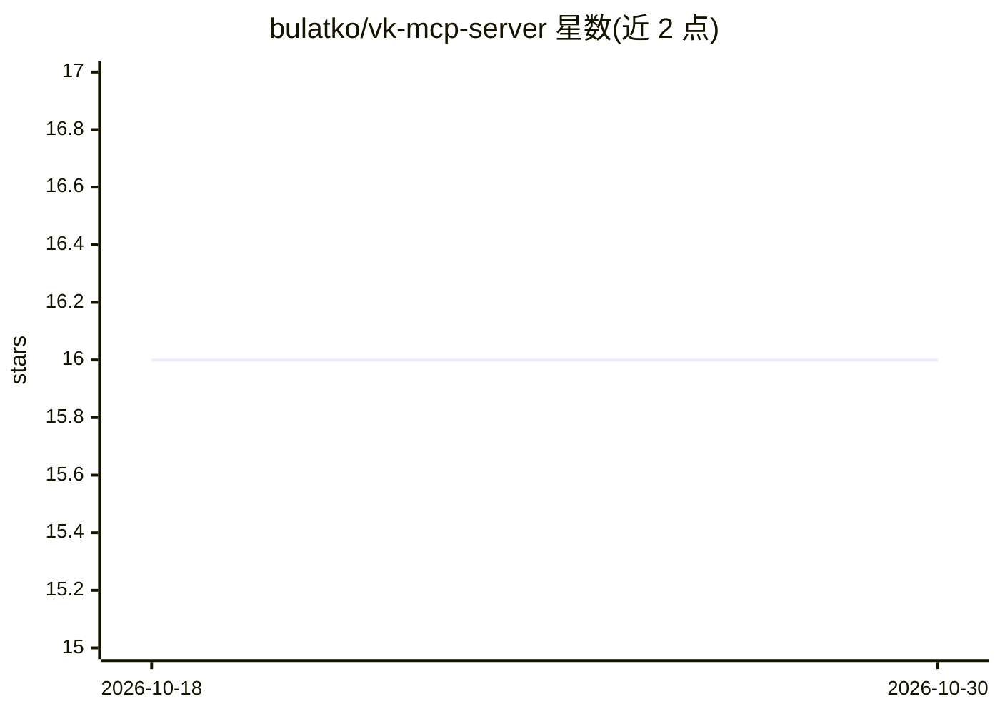

# bulatko/vk-mcp-server

⭐ 16 · JavaScript · MIT · 推送 2026-10-10 · [GitHub](https://github.com/bulatko/vk-mcp-server) · [官网](https://www.npmjs.com/package/vk-mcp-server) · 个人维护

**让 Claude 等 AI 助手操作 VK 社交网络 API 的 MCP 服务器**

面向 VK（VKontakte）社交平台 API 的 Model Context Protocol 服务器，以 npm 包与一键安装包（.mcpb）形式分发，供 Claude Desktop、Claude Code、VS Code 等支持 MCP 的客户端调用。提供覆盖用户、公共主页（wall）、社区、照片、快拍、社区消息、点赞与统计的 25 个工具，其中写入类操作（发帖、评论、以社区身份回私信）带注解标记以触发客户端确认。机制上按 token 类型（社区 token、服务密钥、VK ID token）动态裁剪可见工具集，--check 可探测 token 实际权限；限制是 VK 不再向新应用发放完整用户 token，搜索、统计、相册读取等能力因此不可用。含请求超时与限流退避，附带 140+ 协议级测试。

## 筛选速览

| 维度 | 判定 | 备注 |
|---|---|---|
| AI 角色 | `ai-ecosystem` | LLM/agent 周边工具 |
| 许可风险 | `permissive` | MIT |
| 部署形态 | `desktop` | 安装包/桌面程序 |
| 模型依赖 | — | README 未给出锁定关系 |
| 硬件要求 | — | 无带数字的原话,不猜 |
| 安装摩擦 | `low` | 无编译、无系统依赖或容器化 |
| 成熟度 | — | 结构信号不足 |

## 能力要点

- 25 个工具覆盖用户/主页/社区/照片/快拍/社区消息/统计
- 按 token 类型动态裁剪工具列表，--check 探测 token 实际可达范围
- 在支持 MCP Apps 的客户端中将主页、社区、个人资料渲染为卡片
- 写入类工具带 readOnlyHint/destructiveHint 注解供客户端审批

## 适用场景

- 让 AI 助手读取并管理我的 VK 社区主页与发帖
- 以社区身份处理 VK 收件箱私信（助手起草、我批准后发送）
- 在 Claude Desktop / VS Code 中一键接入 VK 数据查询

## 场景标签

 · 领域:社交网络/AI 工具接入

## 证据(README 行号)

> L10:  Model Context Protocol (MCP) server for VK (VKontakte) social network API
> L14:  Enables AI assistants like Claude to interact with VK through a standardized interface.

## 星数曲线

2026-10-18 16 → 2026-10-30 16（+0）

---
*卡片 v1 · prompt 1.4 · 生成 2026-10-30 · 置信度 high · 依据 README sha `bfd8b2a0d93c` · [字段定义](../../DATASET.md)*
