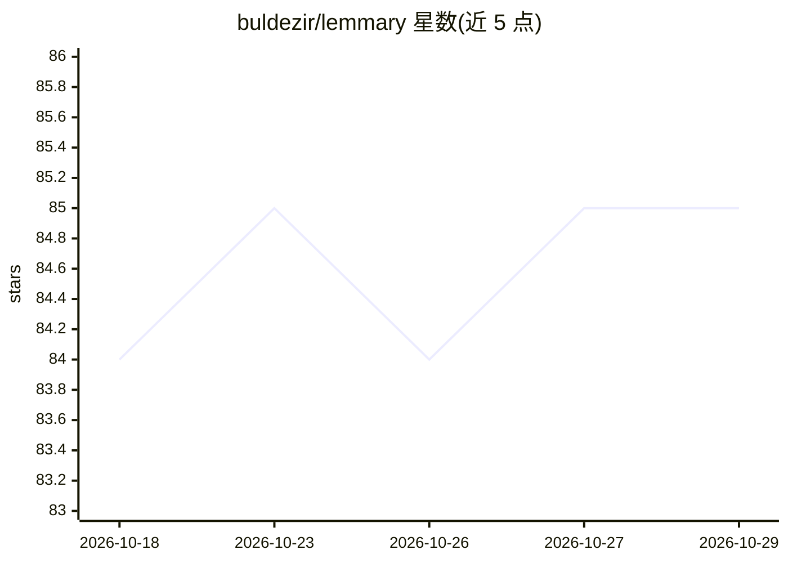

# buldezir/lemmary

⭐ 85 · Go · NOASSERTION · 推送 2026-10-28 · [GitHub](https://github.com/buldezir/lemmary) · [官网](https://lemmary.app) · 个人维护

**自托管文档库：扫描/PDF/办公文件上传、OCR 与 AI 元数据提取、自然语言检索**

Go + PocketBase 后端与 React 前端的自托管文档管理系统。上传 PDF、图片、Office 文件后由 OCR 引擎（Mistral/Google Vision/Docling 等）提取文本，再用 OpenAI 兼容的 AI 提供商抽取标题、日期、标签与摘要，并在收件箱中供人工审校。搜索基于 Bleve 全文索引，含 AI 辅助检索与 Deep Research 两条 RAG 路径，后者以工具调用 agent 通读文档并生成带引用的回答。另实现部分 paperless-ngx 兼容 REST API，支持从 Paperless-ngx/Papra 迁移。许可为 source-available 而非开源。Docker Compose 部署，首次启动需配置 OCR 与 LLM API key。

## 筛选速览

| 维度 | 判定 | 备注 |
|---|---|---|
| AI 角色 | `ai-enhanced` | 去掉 AI 部分产品仍成立 |
| 许可风险 | `none` | NOASSERTION |
| 部署形态 | `self-host` | docker 或自建部署 |
| 模型依赖 | locked-api |  |
| 硬件要求 | — | 无带数字的原话,不猜 |
| 安装摩擦 | `low` | 无编译、无系统依赖或容器化 |
| 成熟度 | — | 结构信号不足 |

## 能力要点

- OCR 文本提取与 AI 元数据抽取（标题/日期/类型/标签/摘要），低置信结果进入审校收件箱
- AI 辅助搜索与 Deep Research：工具调用 agent 通读文档、跨库统计并输出带引用的回答
- 实现部分 paperless-ngx 兼容 REST API，可配合 swift-paperless 等第三方客户端
- 网络扫描仪直扫（eSCL/AirScan）、监控文件夹、IMAP 邮箱附件、Paperless-ngx/Papra 迁移等多种入库途径

## 适用场景

- 自建纸质/电子文档归档库并用自然语言检索与研究
- 从 Paperless-ngx 迁移文档并继续使用原有移动客户端
- 对低置信 AI 抽取结果进行人工审校后归档

## 场景标签

`RAG` `OCR` `文档问答` · 领域:知识与检索

## 证据(README 行号)

> L3: Document storage built with Go + PocketBase and a React + TanStack Router frontend. Upload documents, run OCR, extra
> L25: - Two search pages, one per path: **AI assisted search** (`/rag/search`) finds documents and lists them as cards; *

## 星数曲线

2026-10-18 84 → 2026-10-29 85（+1）

---
*卡片 v1 · prompt 1.4 · 生成 2026-10-24 · 置信度 high · 依据 README sha `d05b82d4d16e` · [字段定义](../../DATASET.md)*
