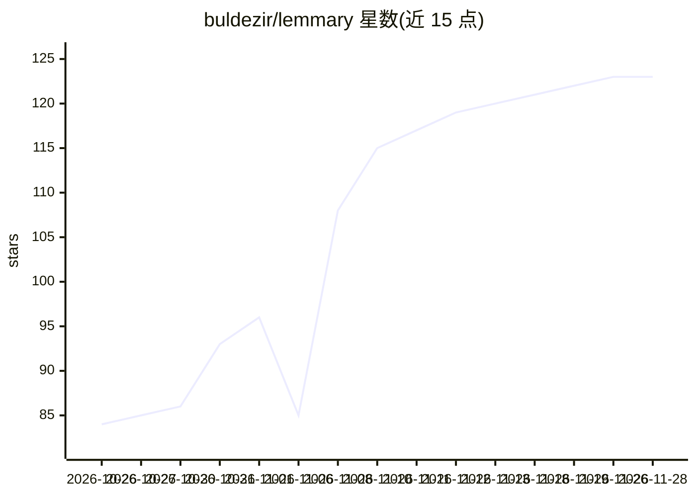

# buldezir/lemmary

⭐ 123 · Go · NOASSERTION · 推送 2026-11-27 · [GitHub](https://github.com/buldezir/lemmary) · [官网](https://lemmary.app) · 个人维护

**将扫描件与办公文档组织为可自然语言检索的文档库**

基于 Go + PocketBase 后端与 React 前端的自托管文档管理系统：上传 PDF、图片、Word、Excel 等文件后执行 OCR，通过 AI 提取标题、日期、类型、标签与摘要，并提供全文搜索、AI 辅助搜索与 Deep Research 两个 RAG 页面（后者阅读检索到的文档并给出带引用的回答）。支持网络扫描仪直连、IMAP 附件摄取、监视文件夹、Amazon 订单导入、从 Paperless-ngx/Papra 迁移、全库备份恢复与静态加密；实现 paperless-ngx 兼容 REST API。许可为 source-available，非开源。

## 筛选速览

| 维度 | 判定 | 备注 |
|---|---|---|
| AI 角色 | `ai-native` | 本体是模型或模型工具 |
| 许可风险 | `none` | NOASSERTION |
| 部署形态 | `self-host` | docker 或自建部署 |
| 模型依赖 | locked-api |  |
| 硬件要求 | — | 无带数字的原话,不猜 |
| 安装摩擦 | `low` | 无编译、无系统依赖或容器化 |
| 成熟度 | — | 结构信号不足 |

## 能力要点

- OCR 支持 Mistral Document OCR、Google Cloud Vision、docling 等多后端
- AI 辅助搜索与 Deep Research 页面，输出带来源链接的引用回答
- 实现 paperless-ngx 兼容 REST API，可接第三方客户端
- 支持监视文件夹、IMAP 邮箱摄取与全库 zip 备份恢复

## 适用场景

- 把纸质扫描件和 PDF 整理成可搜索的个人文档库
- 用自然语言提问并让系统引用库内文档作答
- 从 Paperless-ngx 迁移文档并保留标签与 OCR 文本

## 场景标签

`RAG` `OCR` `文档解析` `文档问答` · 领域:知识与检索

## 证据(README 行号)

> L3: Document storage built with Go + PocketBase and a React + TanStack Router frontend. Upload documents, run OCR, extra
> L25: - Two search pages, one per path: **AI assisted search** (`/rag/search`) finds documents and lists them as cards; *
> L70: - **OCR:** Mistral Document OCR (`mistral`), Google Cloud Vision (`google_vision`), a file-capable OpenAI/OpenRoute

## 星数曲线

2026-10-26 84 → 2026-11-28 123（+39）

---
*卡片 v1 · prompt 1.4 · 生成 2026-11-28 · 置信度 high · 依据 README sha `657a17cdeb28` · [字段定义](../../DATASET.md)*
