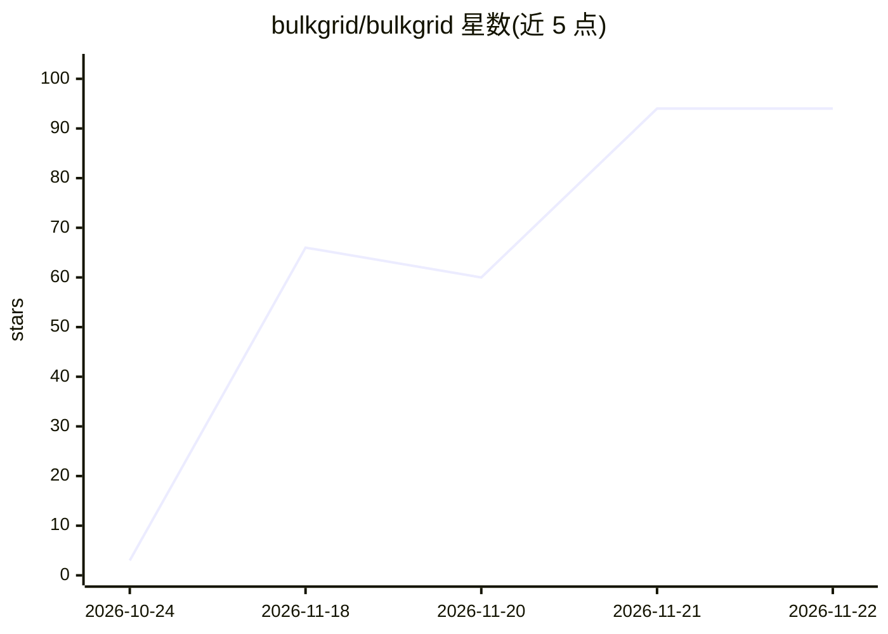

# bulkgrid/bulkgrid

⭐ 94 · TypeScript · 推送 2026-11-17 · [GitHub](https://github.com/bulkgrid/bulkgrid) · [官网](https://bulkgrid.com) · 组织维护

**面向开发者的网络数据获取与索引平台 SDK，为 AI 应用供检索**

Bulkgrid 托管服务的公开开发工具仓库：提供 TypeScript/Python SDK、CLI 与远程 MCP 服务器，功能包括实时网页搜索、sitemap URL 发现、页面抓取转 Markdown、按 JSON schema 抽取结构化数据，以及构建可检索的索引与集合。后端、爬取引擎与计费在私有仓库维护，本仓库不可自托管。MCP 支持 Claude 与 ChatGPT 客户端接入，返回带来源 URL 的段落；CLI 附带六个 agent 技能。

## 筛选速览

| 维度 | 判定 | 备注 |
|---|---|---|
| AI 角色 | `ai-ecosystem` | LLM/agent 周边工具 |
| 许可风险 | `none` | — |
| 部署形态 | `library` | 以包/库形式分发 |
| 模型依赖 | — | README 未给出锁定关系 |
| 硬件要求 | — | 无带数字的原话,不猜 |
| 安装摩擦 | `low` | 无编译、无系统依赖或容器化 |
| 成熟度 | — | 结构信号不足 |

## 能力要点

- 网页搜索/URL 发现/抓取/结构化抽取/索引检索五类能力
- 远程 MCP 服务器向 Claude、ChatGPT 提供带来源的检索
- CLI 附带六个 agent 技能（索引、搜索、抓取、抽取、解析、源管理）
- 后端闭源托管，仓库仅含 SDK/CLI/插件等公开开发工具

## 适用场景

- 为 AI agent 接入可溯源的网页与文档检索
- 把网站与 GitHub 内容构建成可搜索索引
- 批量抓取网页并转为 Markdown 或结构化字段

## 场景标签

`网页抓取` `语义搜索` `文档解析` · 领域:效率与自动化

## 证据(README 行号)

> L110: ## Connect your AI agent
> L184: These tools connect to the hosted Bulkgrid service. The API backend, MCP service, crawling and indexing engines, d

## 星数曲线

2026-10-24 3 → 2026-11-22 94（+91）

---
*卡片 v1 · prompt 1.4 · 生成 2026-11-18 · 置信度 high · 依据 README sha `6244a8f55789` · [字段定义](../../DATASET.md)*
