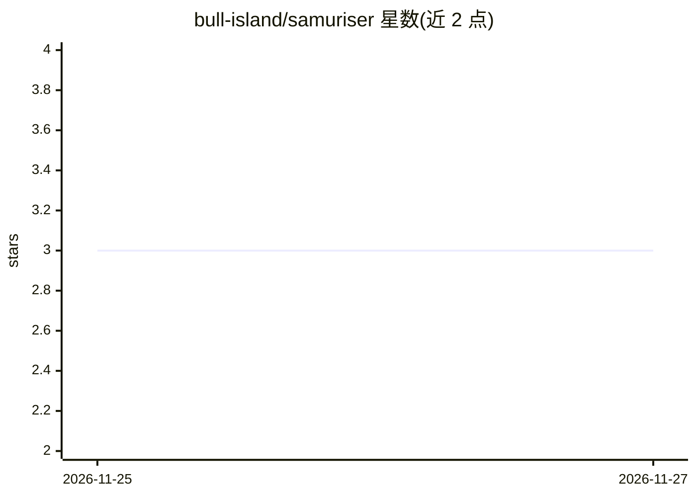

# bull-island/samuriser

⭐ 3 · Python · MIT · 推送 2026-11-23 · [GitHub](https://github.com/bull-island/samuriser) · 个人维护

**AI 剪掉视频和文章冗余部分的本地摘要工具**

面向 Mac 用户的本地优先摘要工具：保存 YouTube 视频或文章后，由 Claude 读取字幕/文本，生成摘要、要点，并判定无信息量的片段（片头、重复、赞助内容），播放器跳过这些片段，每一刀可查看原因并可恢复。视频在 YouTube 原生播放器中播放；库保存在本机文件夹，无托管服务与遥测。要求 Apple Silicon Mac 与 Chrome，通过 Claude Code 登录或 Anthropic API key 调用，本地语音转录模型从 Hugging Face 一次性下载。

## 筛选速览

| 维度 | 判定 | 备注 |
|---|---|---|
| AI 角色 | `ai-native` | 本体是模型或模型工具 |
| 许可风险 | `permissive` | MIT |
| 部署形态 | `None` |  |
| 模型依赖 | locked-api |  |
| 硬件要求 | — | 无带数字的原话,不猜 |
| 安装摩擦 | `medium` | 含编译或系统依赖之一 |
| 成熟度 | — | 结构信号不足 |

## 能力要点

- Claude 判定并跳过视频冗余片段，剪切原因逐条可查、可恢复
- 本地优先：库存于本机，无托管服务、无账号、无遥测
- Chrome 扩展一键保存页面/视频，支持 YouTube 播放列表收件箱
- 可发布只读副本到 S3 兼容存储（如 Cloudflare R2）供手机阅读

## 适用场景

- 以约一半时长看完一小时的技术演讲
- 保存文章生成摘要并用朗读功能收听
- 通过 YouTube 播放列表从手机批量收集待看视频

## 场景标签

`AI 写作` · 领域:内容生成

## 证据(README 行号)

> L3: **Watch a one-hour talk in about half the time.** Samuriser is an AI summariser for YouTube videos and articles. It 
> L15: You need an Apple Silicon Mac, Chrome, and either a signed-in Claude Code or an Anthropic API key.
> L40: 2. Claude reads the transcript, writes a summary and key ideas, and decides which parts teach nothing: intros, reca

## 星数曲线

2026-11-25 3 → 2026-11-27 3（+0）

---
*卡片 v1 · prompt 1.4 · 生成 2026-11-24 · 置信度 high · 依据 README sha `b0abe9a8cbb7` · [字段定义](../../DATASET.md)*
