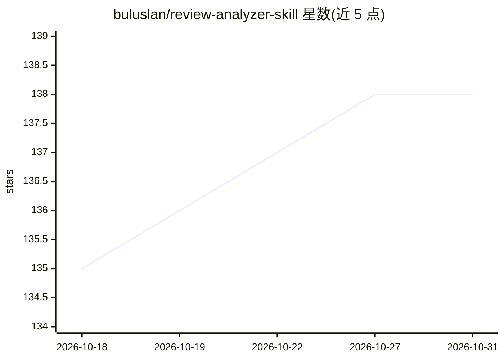

# buluslan/review-analyzer-skill

⭐ 138 · Python · MIT · 推送 2026-09-17 · [GitHub](https://github.com/buluslan/review-analyzer-skill) · 个人维护 · 中文 README

**Agent 原生的电商评论分析 Skill：22维打标、生成15章洞察报告**

面向跨境电商从业者的电商评论分析工具（VOC 客户之声分析），以 SKILL.md 指令驱动的 Agent 原生 Skill 形式提供，适配 Claude Code、Codex、Cursor、OpenCode 等 AI Coding Agent。流程分四阶段：本地 CSV 或卖家精灵数据导入、22 维度 AI 打标（并发4）、用户画像识别、生成 15 章洞察报告并输出 6 套主题 HTML 看板，可同步飞书文档与白板（需 lark-cli，可选）。零 API Key，LLM 工序由宿主 Agent 自执行，另保留 CLI headless 后备模式。需 Python 3.10+。

## 筛选速览

| 维度 | 判定 | 备注 |
|---|---|---|
| AI 角色 | `ai-native` | 本体是模型或模型工具 |
| 许可风险 | `permissive` | MIT |
| 部署形态 | `library` | 以包/库形式分发 |
| 模型依赖 | — | README 未给出锁定关系 |
| 硬件要求 | — | 无带数字的原话,不猜 |
| 安装摩擦 | `low` | 无编译、无系统依赖或容器化 |
| 成熟度 | — | 结构信号不足 |

## 能力要点

- 22 维度 AI 打标（人群/场景/功能等）+ 用户画像识别
- 15 章深度洞察报告（含异常信号卡、行动决策仪表盘）
- 6 套主题 HTML 可视化看板（Chart.js、玻璃拟态）
- 飞书文档 + mermaid 白板自动同步（可选，需 lark-cli）

## 适用场景

- 分析自己产品评论发现痛点、指导产品优化
- 分析竞品评论寻找差异化机会
- 批量分析多个产品评论做市场调研
- 构建用户画像优化营销策略

## 场景标签

`数据分析` · 领域:效率与自动化

## 证据(README 行号)

> L22: review-analyzer-skill 是由 buluslan（公众号：新西楼.AI）研发的电商评论深度分析 Skill（VOC 客户之声分析），他会帮你把一堆产品评论变成一份能落地的决策依据——22 维 AI 打标提炼用户画
> L27: 作为 **Agent 原生** 工具，它适配 Claude Code、Codex、Cursor、OpenCode 等主流 AI Coding Agent，支持本地 CSV 数据导入和 卖家精灵 平台数据对接（可选增强），零 API
> L48: Phase 1: AI 深度打标（并发4，22维度标签）

## 星数曲线

2026-10-18 135 → 2026-10-31 138（+3）

---
*卡片 v1 · prompt 1.4 · 生成 2026-10-22 · 置信度 high · 依据 README sha `e07f2c4d56c4` · [字段定义](../../DATASET.md)*
