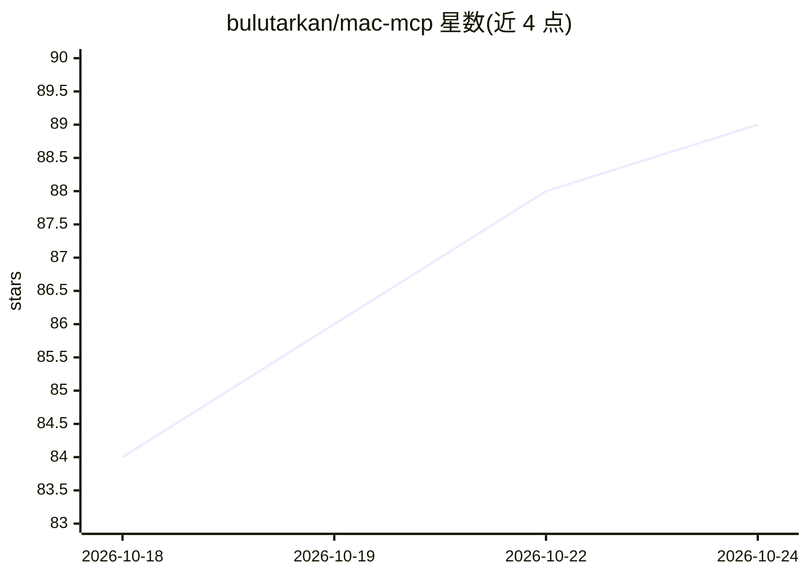

# bulutarkan/mac-mcp

⭐ 91 · Python · MIT · 推送 2026-10-23 · [GitHub](https://github.com/bulutarkan/mac-mcp) · [官网](https://bulutarkan.github.io/mac-mcp/) · 个人维护

**让 Claude/ChatGPT 等 AI 应用操控你 Mac 的本地 MCP 服务器**

面向 macOS 的本地服务器与菜单栏应用：通过 MCP 协议让 Claude Desktop、ChatGPT、Codex、OpenCode 等 AI 应用操作 Mac 的应用、文件、终端和浏览器，操作经由 macOS Accessibility 与可见的 Safari/Chrome 自动化完成，关键动作需用户审批。支持向 10 个 agent CLI 委派任务、基于本地文档索引的问答（索引留在本机）、定时任务与 Recipes 一键重放。提供 .pkg 安装包（Apple Silicon，macOS 14+）与 shell/npx 安装脚本（macOS 13+），MIT 许可。

## 筛选速览

| 维度 | 判定 | 备注 |
|---|---|---|
| AI 角色 | `ai-ecosystem` | LLM/agent 周边工具 |
| 许可风险 | `permissive` | MIT |
| 部署形态 | `desktop` | 安装包/桌面程序 |
| 模型依赖 | — | README 未给出锁定关系 |
| 硬件要求 | — | 无带数字的原话,不猜 |
| 安装摩擦 | `low` | 无编译、无系统依赖或容器化 |
| 成熟度 | — | 结构信号不足 |

## 能力要点

- 通过 macOS Accessibility 操作 Notes/Finder/Mail 等原生应用
- Safari/Chrome 可见、不抢焦点的浏览器自动化
- 向 Codex、Claude Code 等 10 个 agent CLI 委派任务并读取报告
- 文档问答的索引保留在本机，权限配置与 Server Approval 审批机制

## 适用场景

- 让 Claude/ChatGPT 直接在 Mac 上替我操作应用、文件和浏览器
- 把重复性 AI 任务做成定时任务或一键重放的 Recipes
- 让 agent 基于我的合同、发票等本地文档回答问题并给出出处

## 场景标签

`浏览器自动化` `GUI 自动化` `文档问答` `工作流自动化` · 领域:效率与自动化

## 证据(README 行号)

> L5: **Let your AI apps use your Mac.** Mac MCP is a local server and menu bar app that lets Claude, ChatGPT, Codex, Open
> L9: - **It hands off work and reports back.** Delegate a task to Codex, Claude Code, OpenCode or one of seven other agen

## 星数曲线

2026-10-18 84 → 2026-10-24 89（+5）

---
*卡片 v1 · prompt 1.4 · 生成 2026-10-23 · 置信度 high · 依据 README sha `b12ea6f45682` · [字段定义](../../DATASET.md)*
