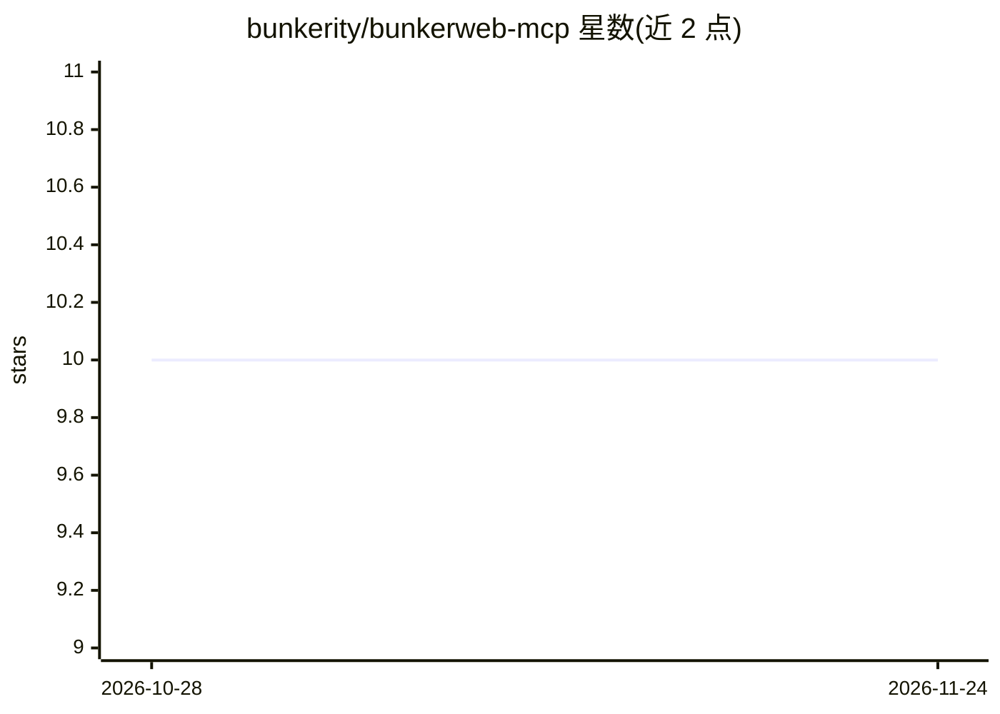

# bunkerity/bunkerweb-mcp

⭐ 10 · Python · MIT · 推送 2026-11-23 · [GitHub](https://github.com/bunkerity/bunkerweb-mcp) · [官网](https://www.bunkerweb.io) · 组织维护

**向 MCP 客户端暴露 BunkerWeb API 的服务器**

BunkerWeb 官方 MCP 服务器：将 BunkerWeb 的 REST API 以 36 个工具、13 个 Agent Skills、只读资源与提示目录的形式暴露给 MCP 客户端，用于管理服务、实例、封禁 IP、配置片段、插件与调度任务。服务器本身不持有 BunkerWeb 状态，每个工具调用转发为对 BunkerWeb API 的请求。支持 streamable HTTP 与 stdio 两种传输，保留旧版 JSON-RPC HTTP 与 WebSocket 端点。提供共享密钥校验、MCP_READ_ONLY 只读模式与密钥脱敏等安全机制。

## 筛选速览

| 维度 | 判定 | 备注 |
|---|---|---|
| AI 角色 | `ai-ecosystem` | LLM/agent 周边工具 |
| 许可风险 | `permissive` | MIT |
| 部署形态 | `self-host` | docker 或自建部署 |
| 模型依赖 | — | README 未给出锁定关系 |
| 硬件要求 | — | 无带数字的原话,不猜 |
| 安装摩擦 | `low` | 无编译、无系统依赖或容器化 |
| 成熟度 | — | 结构信号不足 |

## 能力要点

- 36 个 API 工具覆盖实例、封禁、服务配置、插件与调度任务管理
- 13 个 Agent Skills 通过 skill:// 资源提供
- streamable HTTP 与 stdio 双传输，兼容旧版 JSON-RPC/WebSocket 端点
- MCP_READ_ONLY 只读模式、共享密钥与密钥脱敏机制

## 适用场景

- 通过 Claude Code/Claude Desktop 等 MCP 客户端管理 BunkerWeb 防火墙
- 用自然语言或自动化流程执行封禁 IP、更新服务配置等操作
- 以 Docker Compose 搭建包含 BunkerWeb 与 MCP 服务器的演示栈

## 场景标签

`网络安全` `工作流自动化` · 领域:效率与自动化

## 证据(README 行号)

> L7:  Expose the BunkerWeb API to MCP clients through tools, read-only resources, and tool guidance prompts.
> L33: The server holds no BunkerWeb state. It turns each tool call into a request to the BunkerWeb API.
> L35:  Architecture: an MCP client talks to the BunkerWeb MCP server over streamable HTTP or stdio. The server calls the 

## 星数曲线

2026-10-28 10 → 2026-11-24 10（+0）

---
*卡片 v1 · prompt 1.4 · 生成 2026-11-19 · 置信度 high · 依据 README sha `b3b1403a7a2b` · [字段定义](../../DATASET.md)*
