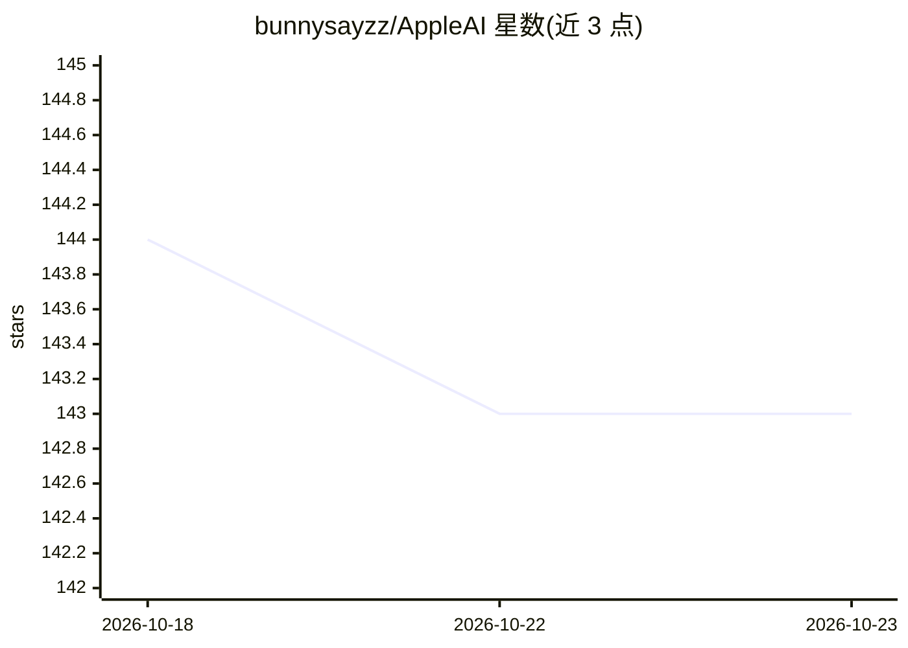

# bunnysayzz/AppleAI

⭐ 143 · Swift · 推送 2026-09-17 · [GitHub](https://github.com/bunnysayzz/AppleAI) · [官网](https://bunnysayzz.itch.io/utilix) · 个人维护

**macOS 菜单栏 AI 助手聚合客户端（已归档）**

Swift/SwiftUI 编写的 macOS 菜单栏应用，以 WKWebView 打开各 AI 服务官网，在常驻置顶的紧凑窗口中切换 ChatGPT、Claude、Copilot、Perplexity、DeepSeek、Grok 等 14 个服务；提供 ⌘E 全局快捷键、每个助手的持久会话、主题与本地存储的偏好设置。仓库已归档停止维护，最后的 DMG 版本仍可用，作者引导用户转用后继产品 Utilix。兼容 macOS 12 及以后的 Apple Silicon 与 Intel 机型。

## 筛选速览

| 维度 | 判定 | 备注 |
|---|---|---|
| AI 角色 | `ai-native` | 本体是模型或模型工具 |
| 许可风险 | `none` | — |
| 部署形态 | `desktop` | 安装包/桌面程序 |
| 模型依赖 | — | README 未给出锁定关系 |
| 硬件要求 | — | 无带数字的原话,不猜 |
| 安装摩擦 | `low` | 无编译、无系统依赖或容器化 |
| 成熟度 | — | 结构信号不足 |

## 能力要点

- 菜单栏一键唤起、置顶固定的紧凑聊天窗口
- 支持 ChatGPT/Claude/Gemini/DeepSeek 等 14 个服务间快速切换
- 各助手会话跨重启持久保存，历史可搜索
- 数据本地存储，通过 WKWebView 直接加载各服务官网

## 适用场景

- 在 Mac 上快速唤起并切换多个 AI 聊天服务，省去多个浏览器标签页
- 工作中保持一个常驻置顶的 AI 助手窗口随手提问
- 让不同 AI 助手的会话集中在一处管理

## 场景标签

`AI 助手` · 领域:对话与助手

## 证据(README 行号)

> L19: Apple AI is a lightweight, privacy‑minded macOS menu bar app that keeps your favorite AI assistants one keystroke a
> L110: - Apple AI runs entirely on your Mac. It opens each service’s official website in a WKWebView.

## 星数曲线

2026-10-18 144 → 2026-10-23 143（-1）

---
*卡片 v1 · prompt 1.4 · 生成 2026-10-22 · 置信度 high · 依据 README sha `4af9c227f00b` · [字段定义](../../DATASET.md)*
