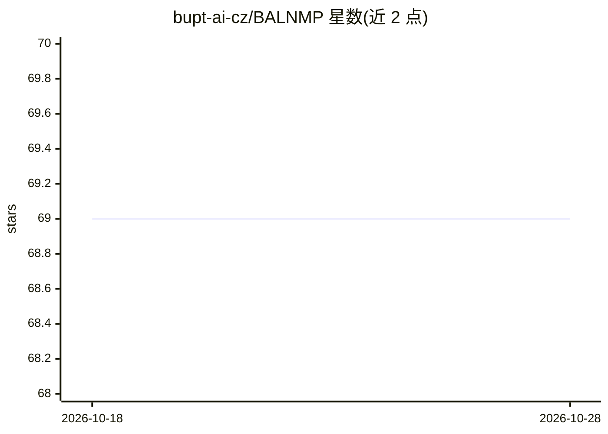

# bupt-ai-cz/BALNMP

⭐ 69 · Python · 推送 2025-11-10 · [GitHub](https://github.com/bupt-ai-cz/BALNMP) · 组织维护 · 中文 README

**深度学习预测早期乳腺癌腋窝淋巴结转移的论文官方实现**

北京邮电大学团队的论文官方代码：基于注意力多示例学习（AMIL）框架，从粗针穿刺活检（CNB）病理切片的全幻灯片图像（WSI）中提取深度特征，术前预测腋窝淋巴结（ALN）转移状态；模型以 VGG16_BN 为特征提取器，可结合年龄、肿瘤大小、ER/PR/HER2 五项临床特征（DL-CNB+C）。提供 BCNB 数据集预处理流程、5 种实验设置的训练脚本（run.sh）、按 bag 聚合的测试结果合并机制，以及仅供演示的桌面软件。Python 3.6 环境，conda 安装依赖，数据需另行下载。

## 筛选速览

| 维度 | 判定 | 备注 |
|---|---|---|
| AI 角色 | `ai-native` | 本体是模型或模型工具 |
| 许可风险 | `none` | — |
| 部署形态 | `desktop` | 安装包/桌面程序 |
| 模型依赖 | — | README 未给出锁定关系 |
| 硬件要求 | — | 无带数字的原话,不猜 |
| 安装摩擦 | `low` | 无编译、无系统依赖或容器化 |
| 成熟度 | — | 结构信号不足 |

## 能力要点

- AMIL 框架 + VGG16_BN 特征提取，从 WSI 预测 ALN 转移
- 支持 5 种淋巴结分期实验设置（N0/N+ 细分）
- 可融合 5 项临床特征的 DL-CNB+C 模型
- 提供 BCNB 数据集（1,058 例患者）与演示软件

## 适用场景

- 复现论文中腋窝淋巴结转移预测实验
- 在 BCNB 数据集上训练或扩展 MIL 病理切片分类模型
- 用演示软件检查模型的预测表现

## 场景标签

 · 领域:医学影像/计算病理学

## 证据(README 行号)

> L15: - Objectives: To develop and validate a deep learning (DL)-based primary tumor biopsy signature for predicting axil
> L17: - Methods: A total of 1,058 EBC patients with pathologically confirmed ALN status were enrolled from May 2010 to Au

## 星数曲线

2026-10-18 69 → 2026-10-28 69（+0）

---
*卡片 v1 · prompt 1.4 · 生成 2026-10-24 · 置信度 mid · 依据 README sha `47b6ebfe5bfc` · [字段定义](../../DATASET.md)*
