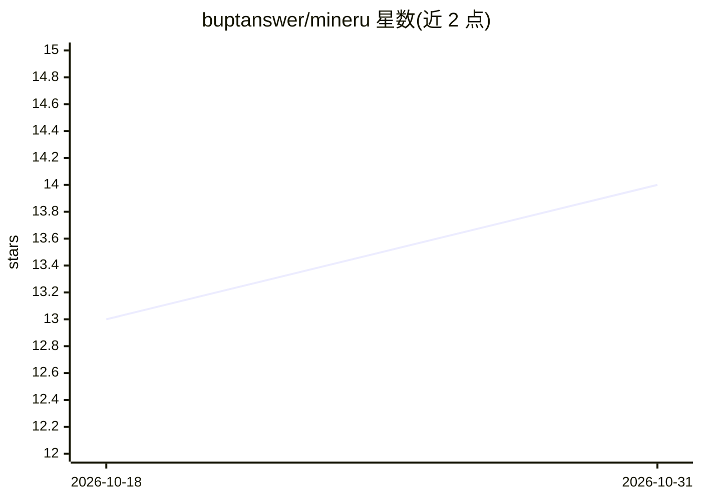

# buptanswer/mineru

⭐ 14 · Python · 推送 2026-05-27 · [GitHub](https://github.com/buptanswer/mineru) · 个人维护 · 中文 README

**MinerU 在 AMD 显卡（ROCm + vLLM）上的本地部署方案与教程**

针对 MinerU 3.x 文档解析工具在 AMD RDNA2/3/4 显卡上的本地部署，提供 ROCm 7.x + PyTorch 2.11 + vLLM 源码编译的完整教程与补丁路径（Ubuntu 22.04+7.1.1 与 24.04+7.2.1 两条已验证路径），含 32 项踩坑清单、模型管理与运维手册，并附带三个无需 GPU 的 Python 辅助脚本（本地 API 客户端、官网云端 API 客户端、Markdown 清理）。面向具备命令行与编译能力的 AMD 显卡用户，部署全程约 2-3 小时，需从源码编译 vLLM。

## 筛选速览

| 维度 | 判定 | 备注 |
|---|---|---|
| AI 角色 | `ai-knowledge` | 知识聚合/清单类 |
| 许可风险 | `none` | — |
| 部署形态 | `None` |  |
| 模型依赖 | local-ok | 支持本地模型 |
| 硬件要求 | `gpu-8g` | |
| 安装摩擦 | `low` | 无编译、无系统依赖或容器化 |
| 成熟度 | — | 结构信号不足 |

## 能力要点

- 两条已验证的 ROCm 部署路径（Ubuntu 22.04+7.1.1 / 24.04+7.2.1）
- vLLM 加速 + hybrid-auto-engine（视觉模型 + OCR）的 AMD 适配方案
- 32 项踩坑清单与运维/更新/模型管理配套文档
- 3 个辅助脚本：本地 API 客户端、云端 API 客户端、Markdown 清理

## 适用场景

- 在 AMD 显卡上本地部署 MinerU 做 PDF 文档解析
- 已有 AMD 显卡的机器搭建本地文档解析服务供 RAG 使用
- Windows 端通过脚本调用 WSL 内的 MinerU 服务

## 场景标签

`文档解析` `教程课程` · 领域:知识与检索

## 证据(README 行号)

> L27: 1. **本地满血运行**：启用 vLLM 加速与 hybrid-auto-engine（视觉模型 + OCR），解析精度无损。
> L60: - 👉 **路径 A（推荐）**：MinerU 本地部署教程.md
> L80: 部署完 MinerU 后，本仓库根目录提供了三个 Python 辅助脚本，可以让 Windows 端调用 WSL 内的 MinerU 服务更顺手。**这些脚本本身不需要 GPU，依赖极少**（仅 `requests` + `htt

## 星数曲线

2026-10-18 13 → 2026-10-31 14（+1）

---
*卡片 v1 · prompt 1.4 · 生成 2026-10-31 · 置信度 high · 依据 README sha `e91b0b52aae9` · [字段定义](../../DATASET.md)*
