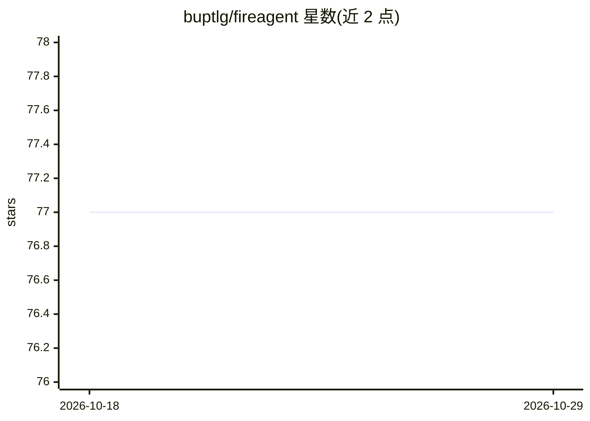

# buptlg/fireagent

⭐ 77 · Python · MIT · 推送 2026-06-18 · [GitHub](https://github.com/buptlg/fireagent) · 组织维护 · 中文 README

**消防隐患图像分析多模态智能体：证据约束的风险判断**

面向消防安全巡检的多模态智能体研究原型：上传场景图片后先抽取视觉事实，再经两跳推理、场景感知混合检索与证据树 RAG 召回消防规则证据，基于证据输出风险等级、隐患结论与整改建议；证据不足时开放集守护触发保守拒绝，另含四层记忆做历史案例与风险趋势管理。提供 FastAPI 后端、静态 Web 页面与微信小程序前端，附检索消融与守护评测脚本。README 声明为研究原型，非认证消防产品。

## 筛选速览

| 维度 | 判定 | 备注 |
|---|---|---|
| AI 角色 | `ai-native` | 本体是模型或模型工具 |
| 许可风险 | `permissive` | MIT |
| 部署形态 | `library` | 以包/库形式分发 |
| 模型依赖 | — | README 未给出锁定关系 |
| 硬件要求 | — | 无带数字的原话,不猜 |
| 安装摩擦 | `low` | 无编译、无系统依赖或容器化 |
| 成熟度 | `idea` | |

## 能力要点

- 两跳推理：视觉事实抽取与证据约束推理解耦
- 场景感知混合检索 + 证据树多路径汇聚 + 次模证据集选择
- 开放集守护：证据不足时保守拒绝或转人工复核
- 四层记忆（核心/任务/短期/长期）跟踪历史案例与风险趋势

## 适用场景

- 消防巡检时上传照片获得带证据引用的风险判断与整改建议
- 对巡检历史做复发隐患与风险趋势的持续治理
- 研究人员复现检索消融与开放集守护评测

## 场景标签

`RAG` `多模态` `Agent 记忆` `模型评测` · 领域:Agent 开发

## 证据(README 行号)

> L11: FireAgent 是一个面向消防安全巡检的多模态智能体系统。它不是简单地把图片丢给大模型生成结论，而是将 **视觉事实抽取、消防法规 RAG、证据树检索、开放集守护与四层记忆机制** 串成一条可解释、可审计、可持续治理的安全分析
> L19: |Task|Fire-safety hazard image analysis|

## 星数曲线

2026-10-18 77 → 2026-10-29 77（+0）

---
*卡片 v1 · prompt 1.4 · 生成 2026-10-24 · 置信度 high · 依据 README sha `80e7f3f9ccc9` · [字段定义](../../DATASET.md)*
