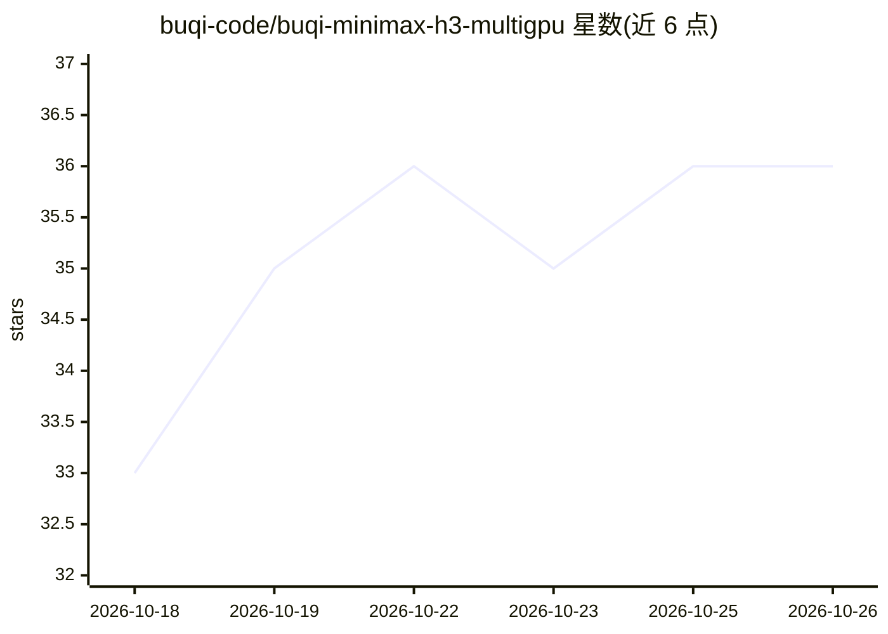

# buqi-code/buqi-minimax-h3-multigpu

⭐ 36 · Python · MIT · 推送 2026-09-28 · [GitHub](https://github.com/buqi-code/buqi-minimax-h3-multigpu) · 个人维护 · 中文 README

**ComfyUI 节点：MiniMax H3 多卡 Ulysses 序列并行推理**

面向 ComfyUI 的自定义节点，将 MiniMax H3 DiT 以 Ulysses 序列并行方式分布到 2-8 张 NVIDIA GPU 上运行，目标为降低单次视频生成的延迟；每张卡持有完整 DiT 权重，不减少权重显存。world_size 须整除 56 个注意力头（1/2/4/7/8）。要求 ComfyUI 特定 commit 后的 H3 API，仅支持 Linux/WSL2（需 PyTorch/NCCL），不支持原生 Windows 多卡。支持 T2V、I2V、R2V、Turbo LoRA 等工作流，不支持 Fun ControlNet、Sparse Attention 等。

## 筛选速览

| 维度 | 判定 | 备注 |
|---|---|---|
| AI 角色 | `ai-ecosystem` | LLM/agent 周边工具 |
| 许可风险 | `permissive` | MIT |
| 部署形态 | `None` |  |
| 模型依赖 | — | README 未给出锁定关系 |
| 硬件要求 | — | 无带数字的原话,不猜 |
| 安装摩擦 | `medium` | 含编译或系统依赖之一 |
| 成熟度 | — | 结构信号不足 |

## 能力要点

- Ulysses 序列并行跨 2-8 GPU 运行 MiniMax H3 DiT，目标降低单次生成延迟
- 每个 rank 持有完整权重，SP 不切分权重显存（与 DP 的差异明确说明）
- 提供 T2V/I2V/R2V/AddGuide/Turbo LoRA 等示例工作流（UI 与 API 格式）
- 提供 CPU 单元测试、双 GPU parity 与 runtime 恢复验收脚本

## 适用场景

- 有多张 NVIDIA 卡的用户在 ComfyUI 中加速 MiniMax H3 视频生成
- 降低单条 prompt 的视频生成延迟
- 在 Linux/WSL2 环境下做多卡序列并行视频+音频生成

## 场景标签

`视频生成` · 领域:内容生成

## 证据(README 行号)

> L5: A ComfyUI custom node that runs the MiniMax H3 DiT with Ulysses sequence parallelism across multiple NVIDIA GPUs.
> L69: - **Sequence parallelism (this project):** one prompt is split across GPUs by sequence/head communication. Every ra
> L80: MINIMAX_SP_DEVICES=0,1 python main.py --cuda-device 0,1 --highvram

## 星数曲线

2026-10-18 33 → 2026-10-26 36（+3）

---
*卡片 v1 · prompt 1.4 · 生成 2026-10-25 · 置信度 high · 依据 README sha `0562cceb4ee6` · [字段定义](../../DATASET.md)*
