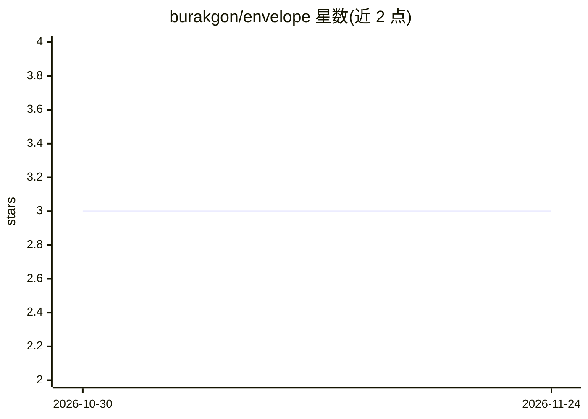

# burakgon/envelope

⭐ 3 · Rust · GPL-3.0 · 推送 2026-10-30 · [GitHub](https://github.com/burakgon/envelope) · [官网](https://burakgon.github.io/envelope/) · 个人维护 · 中文 README

**Linux 邮件与日历桌面客户端，带可选 AI 功能**

面向 Linux 的 Rust+Svelte 邮件/日历/任务/联系人客户端，支持 Gmail、Microsoft 365、Exchange、iCloud 等任何 IMAP 服务器，邮件存于本地 SQLite 数据库，支持离线使用与全文搜索（FTS5）。日历与 CalDAV/Google/M365/Exchange 双向同步，支持 OpenPGP/S/MIME 加密。AI 功能默认关闭、可选开启：摘要、智能回复、翻译与"问收件箱"，由用户自选接入的模型服务商提供，API 密钥存于系统 keyring。提供安装包与源码构建方式。

## 筛选速览

| 维度 | 判定 | 备注 |
|---|---|---|
| AI 角色 | `ai-enhanced` | 去掉 AI 部分产品仍成立 |
| 许可风险 | `viral` | GPL-3.0 |
| 部署形态 | `desktop` | 安装包/桌面程序 |
| 模型依赖 | local-ok | 支持本地模型 |
| 硬件要求 | — | 无带数字的原话,不猜 |
| 安装摩擦 | `medium` | 含编译或系统依赖之一 |
| 成熟度 | — | 结构信号不足 |

## 能力要点

- 本地 SQLite 存储，离线可用，键盘优先操作与命令面板
- CalDAV/Google/M365/Exchange 双向同步的完整日历与任务
- OpenPGP 自动配置（Autocrypt）与 S/MIME 支持，无遥测设计
- 可选 AI：摘要/回复/翻译/问收件箱，支持本地 Ollama 等多种后端

## 适用场景

- 在 Linux 上统一管理多个 IMAP 邮箱与日历
- 离线读写邮件并做即时全文检索
- 开启 AI 后对邮件做摘要、翻译或向收件箱提问

## 场景标签

 · 领域:效率工具/桌面邮件客户端

## 证据(README 行号)

> L5: **A fast, beautiful mail and calendar client for Linux.**
> L28: - **AI you control.** Summaries, smart replies, writing help, translation and "ask your inbox" — using OpenRouter, 
> L95: ### AI (optional)

## 星数曲线

2026-10-30 3 → 2026-11-24 3（+0）

---
*卡片 v1 · prompt 1.4 · 生成 2026-11-22 · 置信度 high · 依据 README sha `808fe0cde6cd` · [字段定义](../../DATASET.md)*
