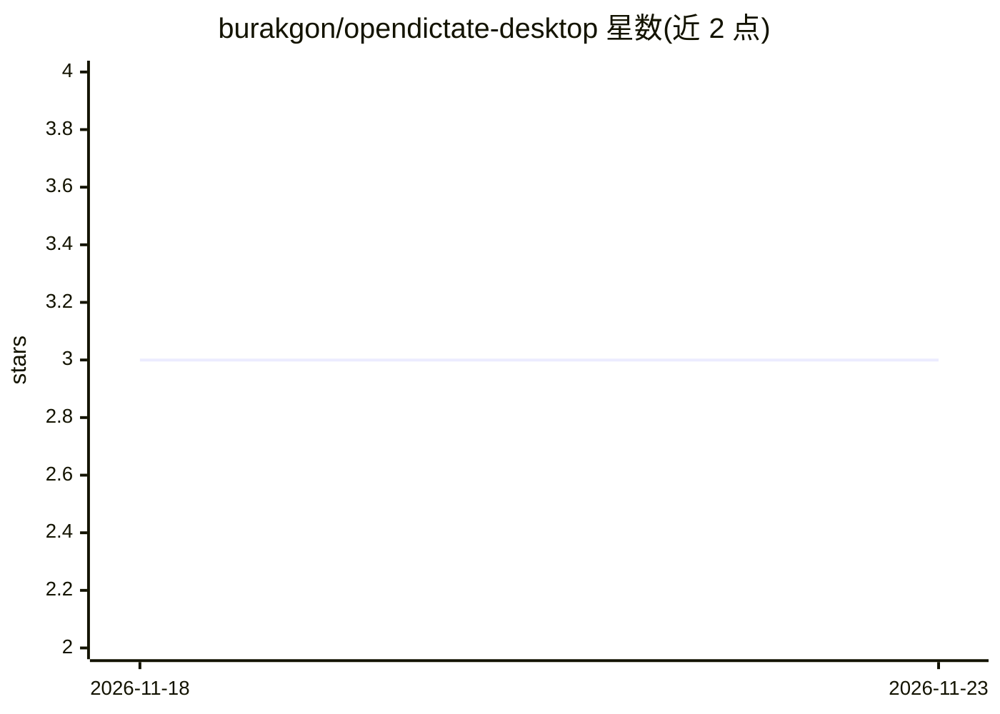

# burakgon/opendictate-desktop

⭐ 3 · Rust · MIT · 推送 2026-11-10 · [GitHub](https://github.com/burakgon/opendictate-desktop) · [官网](https://github.com/burakgon/opendictate-desktop/releases/latest) · 个人维护

**桌面语音输入与语音命令工具：按键即说即录，支持自定义模型**

基于 Tauri/Rust 的桌面应用，提供两项功能：按一次热键将语音转为文字插入任意应用的光标处；长按热键对选中文本下达语音指令（改写、翻译、总结等）。语音识别与指令处理调用用户自备的模型服务，包括 OpenRouter、OpenAI、Groq 或任意 OpenAI 兼容端点（含本地 Whisper/Ollama）。密钥、设置与历史记录保留在本地，无遥测。Linux 为主平台，Windows 标注为实验性且未经真机测试。

## 筛选速览

| 维度 | 判定 | 备注 |
|---|---|---|
| AI 角色 | `ai-native` | 本体是模型或模型工具 |
| 许可风险 | `permissive` | MIT |
| 部署形态 | `desktop` | 安装包/桌面程序 |
| 模型依赖 | local-ok | 支持本地模型 |
| 硬件要求 | — | 无带数字的原话,不猜 |
| 安装摩擦 | `low` | 无编译、无系统依赖或容器化 |
| 成熟度 | — | 结构信号不足 |

## 能力要点

- 按键即说即录，支持任意应用的文本插入
- 长按对选中文本下达语音改写/翻译/总结指令
- 支持 OpenRouter/OpenAI/Groq 及任意 OpenAI 兼容端点，含本地 Whisper/Ollama
- 无账户、无遥测，密钥与历史保留本地

## 适用场景

- 在任意应用中用语音快速输入文字
- 用语音对选中文本执行改写或翻译
- 搭配本地模型实现离线语音输入

## 场景标签

`语音识别` · 领域:感知与多模态

## 证据(README 行号)

> L22: OpenDictate brings the workflow of the Android keyboard Dictate to the desktop: a single key that **types what you 
> L24: It works in every app — your browser, editor, terminal, chat, email — because it simply pastes at your cursor like 
> L35: - 🧠 **Bring your own models.** OpenRouter (hundreds of models with one key), OpenAI, Groq, Mistral, Google Gemini, 

## 星数曲线

2026-11-18 3 → 2026-11-23 3（+0）

---
*卡片 v1 · prompt 1.4 · 生成 2026-11-22 · 置信度 mid · 依据 README sha `e1eb52ca1f53` · [字段定义](../../DATASET.md)*
