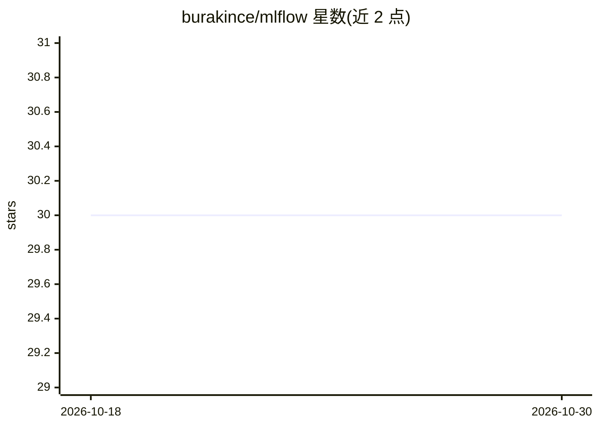

# burakince/mlflow

⭐ 30 · Python · MIT · 推送 2026-10-27 · [GitHub](https://github.com/burakince/mlflow) · 个人维护

**MLflow 追踪服务器的生产可用 Docker 镜像，含多云存储与认证扩展**

面向部署 MLflow 追踪服务器的用户，提供基于 python:3.13-slim（Debian）与 Alpine 两种变体的 Docker 镜像，以非 root 用户（UID/GID 1001）运行。内置 S3/GCS/Azure Blob 多云 artifact 存储支持，可选开启 MLflow 内置 basic auth、mlflow-oidc-auth 的 OIDC 认证及 LDAP/LDAPS 认证（通过环境变量配置）。兼容 PostgreSQL、MySQL、SQL Server 后端数据库，包含 prometheus-flask-exporter 暴露 /metrics 端点，/health 端点可用于就绪探测。

## 筛选速览

| 维度 | 判定 | 备注 |
|---|---|---|
| AI 角色 | `ai-ecosystem` | LLM/agent 周边工具 |
| 许可风险 | `permissive` | MIT |
| 部署形态 | `self-host` | docker 或自建部署 |
| 模型依赖 | — | README 未给出锁定关系 |
| 硬件要求 | — | 无带数字的原话,不猜 |
| 安装摩擦 | `low` | 无编译、无系统依赖或容器化 |
| 成熟度 | — | 结构信号不足 |

## 能力要点

- Debian 与 Alpine 两种镜像变体，非 root 用户运行
- S3/GCS/Azure Blob 多云 artifact 存储后端支持
- basic auth / OIDC / LDAP 三种认证方式可选
- 内置 Prometheus 指标导出与 /health 就绪端点

## 适用场景

- 用一条 docker run 命令快速部署 MLflow 追踪服务器
- 企业内为 MLflow 追踪服务器接入 OIDC 或 LDAP 认证
- 将实验 artifact 存储对接 AWS/GCP/Azure 云存储

## 场景标签

`MLOps` · 领域:训练与推理

## 证据(README 行号)

> L8: A production-ready MLflow Docker image with multi-cloud artifact storage and optional LDAP authentication, published
> L88: docker run -d -p 5000:5000 burakince/mlflow

## 星数曲线

2026-10-18 30 → 2026-10-30 30（+0）

---
*卡片 v1 · prompt 1.4 · 生成 2026-10-26 · 置信度 high · 依据 README sha `a3f94616a3a0` · [字段定义](../../DATASET.md)*
