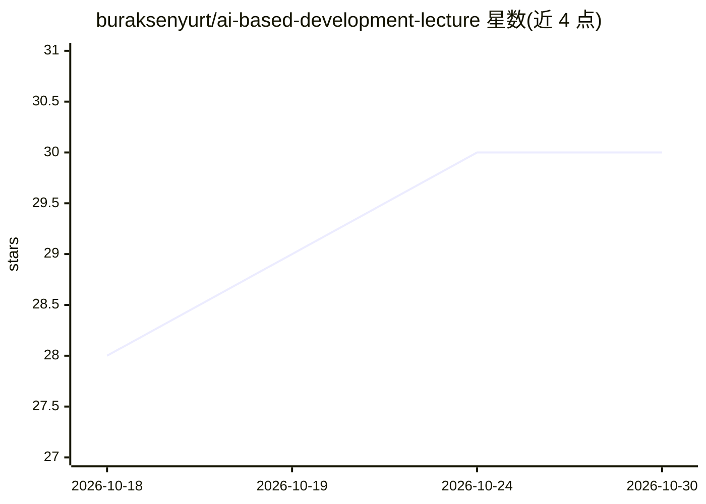

# buraksenyurt/ai-based-development-lecture

⭐ 30 · C# · MIT · 推送 2026-10-23 · [GitHub](https://github.com/buraksenyurt/ai-based-development-lecture) · 个人维护

**AI 辅助软件开发课程讲义与示例仓库（面向大学课堂）**

面向 Konya 食品与农业大学软件工程及 Pamukkale 大学相关专业的课程仓库，收录讲课文档与示例应用。内容围绕将 AI 工具接入软件开发流程：以 AI 周期表讲解 prompt、embedding、RAG、Guardrails 等术语；课程实践中用 Claude Sonnet 模型生成 CV 银行项目（JSON 转 HTML 页面、.NET Clean Architecture 后端、MongoDB、Swagger），并逐步涉及异常处理、调试与 Docker 使用，另附安全、技术债、架构等议题与课后作业。仓库为教学文档与代码集合，非可安装的独立产品。

## 筛选速览

| 维度 | 判定 | 备注 |
|---|---|---|
| AI 角色 | `ai-knowledge` | 知识聚合/清单类 |
| 许可风险 | `permissive` | MIT |
| 部署形态 | `self-host` | docker 或自建部署 |
| 模型依赖 | — | README 未给出锁定关系 |
| 硬件要求 | — | 无带数字的原话,不猜 |
| 安装摩擦 | `low` | 无编译、无系统依赖或容器化 |
| 成熟度 | — | 结构信号不足 |

## 能力要点

- 按教学日（Gün 00/01/02…）组织文档与示例应用
- 以 AI 周期表（Reactive/Retrieval/Orchestration/Validation/Models）组织术语讲解
- 贯穿 CV Bank 示例项目：Claude 模型生成 .NET Clean Architecture 后端与前端页面
- 每课附实践要点（prompt 编写、依赖安全、分块生成代码等）

## 适用场景

- 学习如何将 AI 工具集成进软件开发流程
- 参照 CV Bank 示例逐步实践 AI 辅助开发
- 作为软件工程课程的教学材料

## 场景标签

`教程课程` · 领域:学习与行业

## 证据(README 行号)

> L3: Konya Gıda ve Tarım Üniversitesi Yazılım Mühendisliği ve Pamukkale Üniversitesi Elektrik-Elektronik Mühendisliği ve 
> L10: Yapay zeka araçları günümüzün en popüler konularından biri olsa da, bu araçların yazılım geliştirme süreçlerine ent

## 星数曲线

2026-10-18 28 → 2026-10-30 30（+2）

---
*卡片 v1 · prompt 1.4 · 生成 2026-10-26 · 置信度 mid · 依据 README sha `3c9383cbc4f4` · [字段定义](../../DATASET.md)*
