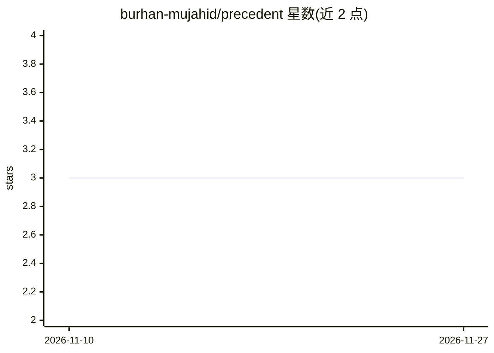

# burhan-mujahid/precedent

⭐ 3 · Python · MIT · 推送 2026-11-11 · [GitHub](https://github.com/burhan-mujahid/precedent) · [官网](https://burhan-mujahid.github.io/precedent/) · 个人维护

**从团队聊天记录挖掘规则供 AI agent 遵循的治理层**

Precedent 从团队的 WhatsApp/Slack 导出或 JSONL 中挖掘问答线索并起草规则草案，每条规则须经人工批准，规则以 YAML 文件形式存于 git。在 agent 执行动作前，五个确定性门控（模型外）判定放行/需人工批准/升级，另有执行门控在运行中逐步检查并可中止；无法覆盖的问题经人工回答后固化为规则与回归测试。提供 Python 库、CLI、HTTP API、MCP server 与代理模式。MIT 许可，Python 3.10-3.13。

## 筛选速览

| 维度 | 判定 | 备注 |
|---|---|---|
| AI 角色 | `ai-ecosystem` | LLM/agent 周边工具 |
| 许可风险 | `permissive` | MIT |
| 部署形态 | `library` | 以包/库形式分发 |
| 模型依赖 | — | README 未给出锁定关系 |
| 硬件要求 | — | 无带数字的原话,不猜 |
| 安装摩擦 | `low` | 无编译、无系统依赖或容器化 |
| 成熟度 | — | 结构信号不足 |

## 能力要点

- 从聊天导出自动挖掘规则草案，每条链接到来源消息
- 五个人外的确定性门控与运行中 check_action 中止机制
- @kb.guarded() 装饰器与 precedent proxy 把门控内置到工具边界
- YAML 规则存于 git，无需数据库/向量库/服务器

## 适用场景

- 为客服/运营 agent 设定退款与审批等业务规则
- 在 agent 执行高风险操作（资金、法律、健康）前强制人工审批
- 将团队既有聊天中的决策惯例沉淀为可版本化规则库

## 场景标签

`Agent 框架` · 领域:Agent 开发

## 证据(README 行号)

> L55: Agents call `consult_rulebook` before acting. **Five deterministic gates outside the model** return one of three ou
> L183: Precedent isn't an agent framework or a memory store. It's the **decision layer underneath** whatever you already 

## 星数曲线

2026-11-10 3 → 2026-11-27 3（+0）

---
*卡片 v1 · prompt 1.4 · 生成 2026-11-22 · 置信度 high · 依据 README sha `9ca6e99fc4e8` · [字段定义](../../DATASET.md)*
