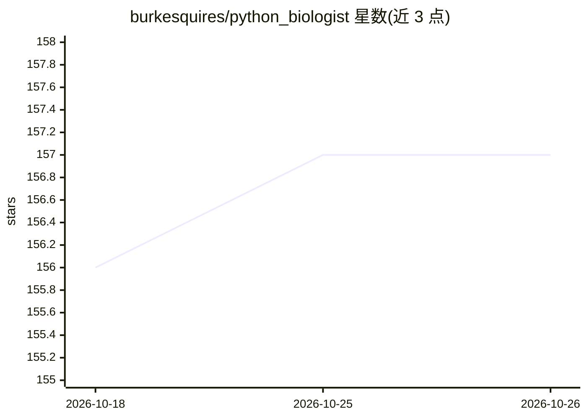

# burkesquires/python_biologist

⭐ 157 · Gnuplot · 推送 2026-02-05 · [GitHub](https://github.com/burkesquires/python_biologist) · 个人维护

**面向生物学家的 Python 教学材料集：Jupyter 笔记本与讲义**

开源教学材料库，源于 2015 年起在 NIAID/NIH 与 NIEHS 开设的培训研讨班，帮助湿实验科学家、分析师和研究人员学习 Python 处理真实生物数据。内容覆盖 UNIX 命令行、Jupyter Notebook、Python 基础与进阶、pandas 数据分析、可视化、生物信息学脚本与流程、自动化工作流、SQL/NoSQL 数据存储与可复现科研工具。以笔记本和幻灯片形式提供，由个人维护者（R. Burke Squires）创建并持续用于 NIH 培训（2015-2025）。

## 筛选速览

| 维度 | 判定 | 备注 |
|---|---|---|
| AI 角色 | `ai-knowledge` | 知识聚合/清单类 |
| 许可风险 | `none` | — |
| 部署形态 | `None` |  |
| 模型依赖 | — | README 未给出锁定关系 |
| 硬件要求 | — | 无带数字的原话,不猜 |
| 安装摩擦 | `low` | 无编译、无系统依赖或容器化 |
| 成熟度 | — | 结构信号不足 |

## 能力要点

- 从零基础到数据分析与生物信息学流程的完整课程路径
- 覆盖 pandas、可视化、SQL/NoSQL 与可复现科研实践
- 由 NIH/NIAID 研讨班演化而来并持续用于机构培训

## 适用场景

- 湿实验科学家零基础学习 Python 分析生物数据
- 生物信息学入门与可复现分析工作流学习
- 研究团队用作 Python 培训课程材料

## 场景标签

`教程课程` `科研工具` `数据分析` · 领域:效率与自动化

## 证据(README 行号)

> L3: *Python Programming for Biologists* is an open set of teaching materials built from a seminar series that started at
> L5: The notebooks and slides in this repository walk through the core skills needed to move from zero Python experience 

## 星数曲线

2026-10-18 156 → 2026-10-26 157（+1）

---
*卡片 v1 · prompt 1.4 · 生成 2026-10-22 · 置信度 high · 依据 README sha `35eb455adb5c` · [字段定义](../../DATASET.md)*
