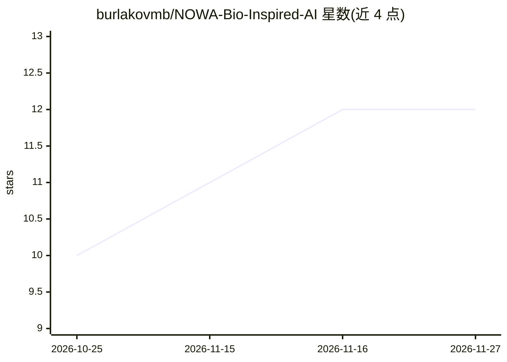

# burlakovmb/NOWA-Bio-Inspired-AI

⭐ 12 · Python · NOASSERTION · 推送 2026-11-26 · [GitHub](https://github.com/burlakovmb/NOWA-Bio-Inspired-AI) · 个人维护 · 中文 README

**无反向传播的认知架构 agent：睡眠、情感与基因组继承**

NOWA 是一个自治 agent 的软件模型与认知架构实现：清醒期写入易变记忆层、选择动作，睡眠期固化为稳定记忆；学习基于局部奖励预测误差，无全局损失与反向传播；8 维情感向量影响行为，模块系数编码在可遗传的基因组中，并可通过表观基因组传给后代。同一核心部署在四个实验平台：龙猫群落的生态仿真、单只电子宠物、虚拟组织采购沙箱、与已发表词汇情感规范的对照。核心仅用 Python 标准库，无语言模型参与。许可为 PolyForm Strict，商用需另行授权。

## 筛选速览

| 维度 | 判定 | 备注 |
|---|---|---|
| AI 角色 | `ai-native` | 本体是模型或模型工具 |
| 许可风险 | `none` | NOASSERTION |
| 部署形态 | `library` | 以包/库形式分发 |
| 模型依赖 | — | README 未给出锁定关系 |
| 硬件要求 | — | 无带数字的原话,不猜 |
| 安装摩擦 | `low` | 无编译、无系统依赖或容器化 |
| 成熟度 | — | 结构信号不足 |

## 能力要点

- 清醒/睡眠双相记忆：稳定记忆仅在 Agent.sleep() 中固化
- 局部奖励预测误差学习，无反向传播与全局损失
- 基因组继承模块系数，表观基因组快照传递给后代
- 同一核心在群落、宠物、虚拟组织、词汇规范对照四种载体上运行

## 适用场景

- 观察多智能体群落中世代更替与社会结构的自组织涌现
- 在采购沙箱中让 agent 在受控环境形成策略再迁移到实际工具
- 长期观察单只带情感与习惯的虚拟生物行为
- 将同一认知核心部署到物理机器人载体的方案参考

## 场景标签

`强化学习` · 领域:训练与推理

## 证据(README 行号)

> L3: **An AI agent that sleeps, feels, and inherits a genome — and learns without backprop.**
> L105: NOWA is a software model of an agent that lives through time. While awake it records what happened and chooses an 
> L107: The subject is a long-lived agent in a changing environment: which traces survive consolidation, how memory, affec

## 星数曲线

2026-10-25 10 → 2026-11-27 12（+2）

---
*卡片 v1 · prompt 1.4 · 生成 2026-11-18 · 置信度 mid · 依据 README sha `1f1c0f0cebe9` · [字段定义](../../DATASET.md)*
