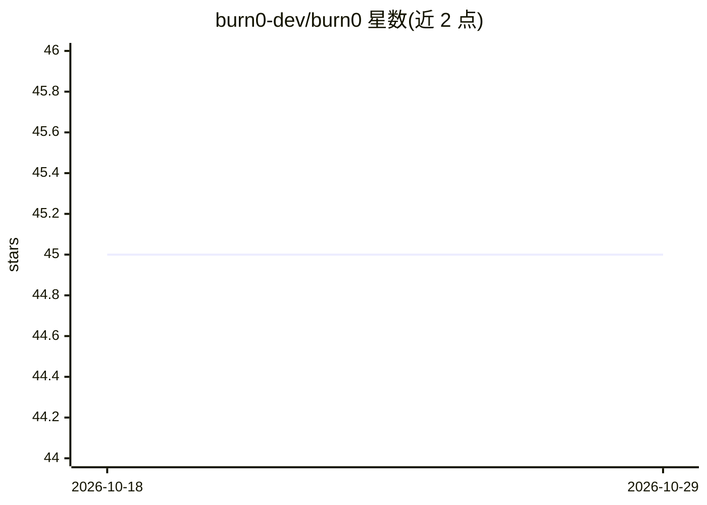

# burn0-dev/burn0

⭐ 45 · TypeScript · MIT · 推送 2026-08-06 · [GitHub](https://github.com/burn0-dev/burn0) · [官网](https://burn0.dev) · 组织维护

**Node.js 应用的 API 调用成本观测库：一次 import 追踪全部费用**

npm 包形式的开源成本观测工具：导入 @burn0/burn0 后通过修补 globalThis.fetch 与 node:http 拦截出站请求，按服务自动识别并按 token 数、请求量或交易量计算成本，在终端实时显示并与本地台账记录。支持 50+ 服务的自动检测，未知 API 按请求计数兜底。本地模式默认无网络上报，可选云端模式同步元数据到 dashboard。要求 Node.js >= 18，云端功能为付费层级。

## 筛选速览

| 维度 | 判定 | 备注 |
|---|---|---|
| AI 角色 | `ai-ecosystem` | LLM/agent 周边工具 |
| 许可风险 | `permissive` | MIT |
| 部署形态 | `library` | 以包/库形式分发 |
| 模型依赖 | — | README 未给出锁定关系 |
| 硬件要求 | — | 无带数字的原话,不猜 |
| 安装摩擦 | `low` | 无编译、无系统依赖或容器化 |
| 成熟度 | — | 结构信号不足 |

## 能力要点

- 一次 import 拦截全部出站请求，自动识别 50+ 服务
- 同步拦截、异步计费，官方口径开销低于 1 毫秒
- 本地模式默认零网络上报，仅记录元数据不读取请求体
- track() 支持按 feature/user/request 归因成本

## 适用场景

- 终端实时查看应用在各 LLM/SaaS API 上的花费
- 按功能模块定位成本来源
- 退出时输出会话成本与月度费用估算

## 场景标签

`LLM 可观测性` · 领域:评测与运维

## 证据(README 行号)

> L196:   ├─ import '@burn0/burn0' patches globalThis.fetch + node:http
> L203: 4. **Never reads content** — only extracts metadata: service, model, tokens, status, latency

## 星数曲线

2026-10-18 45 → 2026-10-29 45（+0）

---
*卡片 v1 · prompt 1.4 · 生成 2026-10-25 · 置信度 high · 依据 README sha `c5ee28bab148` · [字段定义](../../DATASET.md)*
