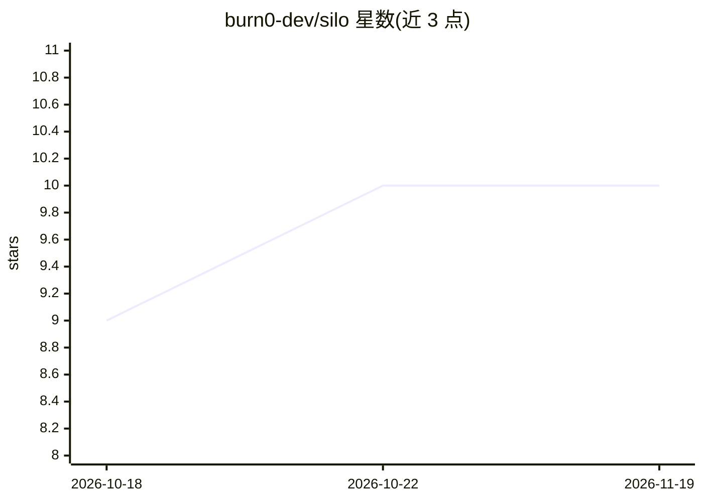

# burn0-dev/silo

⭐ 10 · TypeScript · MIT · 推送 2026-09-15 · [GitHub](https://github.com/burn0-dev/silo) · [官网](https://silo.burn0.dev) · 个人维护

**本地模拟世界评测 AI agent 的 TypeScript 框架**

以 TypeScript 定义模拟环境（数据、状态、工具、任务、校验器），在其中运行 agent 并按世界状态变化而非其自述判定成败。环境与运行产物存于本地 `.silo/` 目录，不出本机；模拟时钟使运行可复现，result.json 与 state-diff.json 无时间戳可作为回归比对基准。通过 CLI 或 SDK 使用，要求 Node.js 22+ 与 ESM 项目，自述处于早期阶段、1.0 前可能有破坏性变更。

## 筛选速览

| 维度 | 判定 | 备注 |
|---|---|---|
| AI 角色 | `ai-ecosystem` | LLM/agent 周边工具 |
| 许可风险 | `permissive` | MIT |
| 部署形态 | `library` | 以包/库形式分发 |
| 模型依赖 | — | README 未给出锁定关系 |
| 硬件要求 | — | 无带数字的原话,不猜 |
| 安装摩擦 | `low` | 无编译、无系统依赖或容器化 |
| 成熟度 | `idea` | |

## 能力要点

- 环境三接口 createState/bindTools/verifiers 定义世界与成败判定
- 校验器检查世界状态而非对话记录，PASS 基于实际变化
- 模拟时钟（state.now）保证运行可复现
- 每次运行产出 trace/result/state-diff 等工件，可作回归比对

## 适用场景

- 在本地沙箱中给 agent 任务并按结果打分
- 用可复现环境做 agent 行为回归测试
- 多次运行同一任务观察 agent 非确定性表现
- 基于自带 CRM/项目跟踪/ERP 模板搭建评测环境

## 场景标签

`模型评测` · 领域:评测与运维

## 证据(README 行号)

> L3:  Local-first simulation and evaluation framework for AI agents.
> L11: Silo lets you define a simulated world — data, state, tools, tasks and verifiers — as
> L66: > **Data** defines the world. **State** gives that world behaviour. **Tools** expose
> L120: - **Verifiers inspect the world, not the transcript.** A task passes because stock moved

## 星数曲线

2026-10-18 9 → 2026-11-19 10（+1）

---
*卡片 v1 · prompt 1.4 · 生成 2026-11-19 · 置信度 high · 依据 README sha `a9f9eb049351` · [字段定义](../../DATASET.md)*
