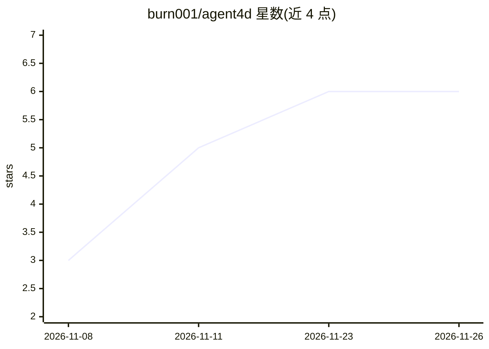

# burn001/agent4d

⭐ 6 · JavaScript · Apache-2.0 · 推送 2026-11-19 · [GitHub](https://github.com/burn001/agent4d) · [官网](https://burn001.github.io/agent4d/) · 个人维护

**本地只读 3D 可视化查看器：实时观察 Claude Code 智能体**

读取 Claude Code 已写入的会话转录文件（~/.claude/projects/），把主智能体、子智能体、workflow 智能体、嵌套 claude -p 运行和后台 shell 汇聚为浏览器中的实时 3D 树状视图，支持 0.5×–32× 回放（空闲间隙压缩）与上下文用量仪表。仅用 Node 内置模块，无需 npm install，不写入转录文件。提供 Flow/Planet/Voxel Office/Voxel Lab 四种视图及慢机器 2D 模式。目前仅在 Windows 上测试过，macOS/Linux 未测试。

## 筛选速览

| 维度 | 判定 | 备注 |
|---|---|---|
| AI 角色 | `ai-ecosystem` | LLM/agent 周边工具 |
| 许可风险 | `permissive` | Apache-2.0 |
| 部署形态 | `desktop` | 安装包/桌面程序 |
| 模型依赖 | — | README 未给出锁定关系 |
| 硬件要求 | — | 无带数字的原话,不猜 |
| 安装摩擦 | `low` | 无编译、无系统依赖或容器化 |
| 成熟度 | — | 结构信号不足 |

## 能力要点

- 读取本地 Claude Code 转录文件，实时流式展示所有智能体活动
- 0.5×–32× 会话回放，空闲间隙压缩与可拖动时间线
- 四种 3D 视图（Flow/Planet/Voxel Office/Voxel Lab），无 WebGL 时自动切 2D
- 随仓库附带 Claude Code skill，可通过对话命令启停

## 适用场景

- 实时查看多个 Claude Code 子智能体各自当前在执行什么工具
- 回放历史会话，观察智能体工作流程
- 监控各会话上下文窗口占用，避免超限

## 场景标签

`LLM 可观测性` · 领域:评测与运维

## 证据(README 行号)

> L13: See what your Claude Code agents are doing, live, in 3D — and play it back later. Agent4D is a local, read-only vie
> L82: The server tails the transcripts that Claude Code already writes under `~/.claude/projects/` (and background task o
> L96: Agent4D reads **Claude Code** today. Adapters for other agent harnesses are welcome as community pull requests — se

## 星数曲线

2026-11-08 3 → 2026-11-26 6（+3）

---
*卡片 v1 · prompt 1.4 · 生成 2026-11-21 · 置信度 mid · 依据 README sha `aeaddb87318f` · [字段定义](../../DATASET.md)*
