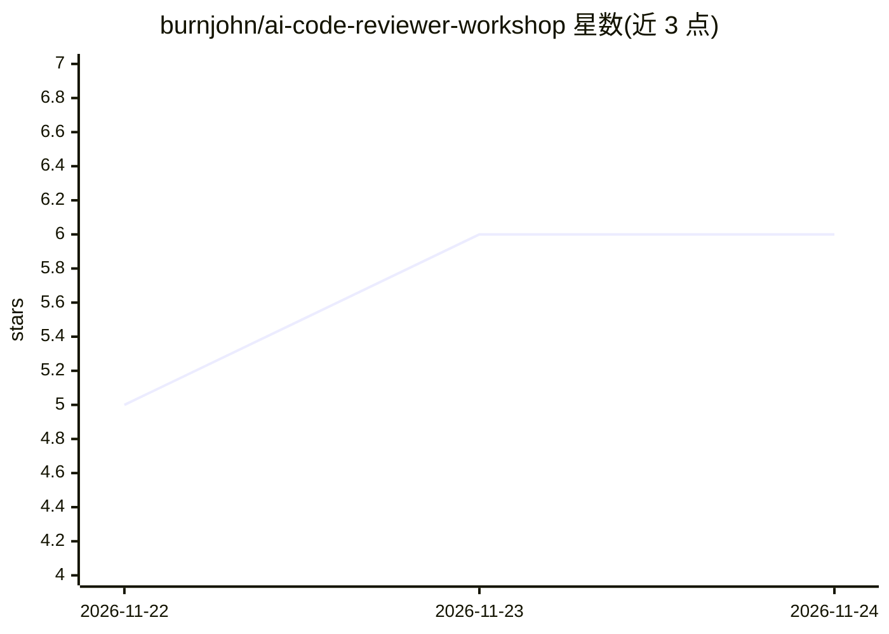

# burnjohn/ai-code-reviewer-workshop

⭐ 6 · JavaScript · MIT · 推送 2026-11-21 · [GitHub](https://github.com/burnjohn/ai-code-reviewer-workshop) · [官网](https://burnjohn.github.io/ai-code-reviewer-workshop/) · 个人维护

**45 分钟动手教程：构建基于 GitHub Action 的 AI 代码评审器**

GDG DevFest Warsaw 2026 的 45 分钟动手 workshop 教程：参与者从模板仓库出发，分 4 个累积步骤构建一个以 GitHub Action 运行的代码评审器——读取整个仓库作为上下文、经 OpenRouter 调用模型获取结构化发现、丢弃引用超出 diff 范围的发现、多专门 agent 并行、最终在代码中判定 pass/fail，人工仍负责合并。提供本地浏览器 UI（含逐 agent 成本与 mock 模式）、录制离线 fixture 的命令，以及将评审器暴露为 MCP 工具的 stretch 分支。核心从 DevDigest 提取简化，MIT 许可。

## 筛选速览

| 维度 | 判定 | 备注 |
|---|---|---|
| AI 角色 | `ai-knowledge` | 知识聚合/清单类 |
| 许可风险 | `permissive` | MIT |
| 部署形态 | `library` | 以包/库形式分发 |
| 模型依赖 | locked-api |  |
| 硬件要求 | — | 无带数字的原话,不猜 |
| 安装摩擦 | `low` | 无编译、无系统依赖或容器化 |
| 成熟度 | — | 结构信号不足 |

## 能力要点

- 分 4 个累积步骤，每步带 spec 与 checkpoint 分支（step-1 至 step-4）
- 结构化输出（json_schema）+ diff grounding：丢弃引用 diff 之外的发现
- 本地 UI：选择 PR/agent/模型/上下文开关，展示 per-agent 成本与 FAIL gate
- review:mock 离线模式使用录制的 PR 与模型答案，无网络可运行

## 适用场景

- 在 45 分钟内动手搭建一个可运行的 AI 代码评审 GitHub Action
- 学习如何用 json_schema 与 grounding 约束模型输出
- 给自己的仓库 PR 挂上带 FAIL gate 的自动评审工作流
- 把评审器封装成 MCP 工具接入编码 agent

## 场景标签

`代码审查` `教程课程` · 领域:编码与开发

## 证据(README 行号)

> L5: Hands-on workshop, GDG DevFest Warsaw 2026 · 45 minutes.
> L9: You build a reviewer that runs as a GitHub Action, reads the repository (not only the diff), calls a model through O
> L36: Each step has a spec in `specs/` with a prompt for your coding agent. Steps are cumulative: step N starts from the 

## 星数曲线

2026-11-22 5 → 2026-11-24 6（+1）

---
*卡片 v1 · prompt 1.4 · 生成 2026-11-22 · 置信度 high · 依据 README sha `2820a0a42046` · [字段定义](../../DATASET.md)*
