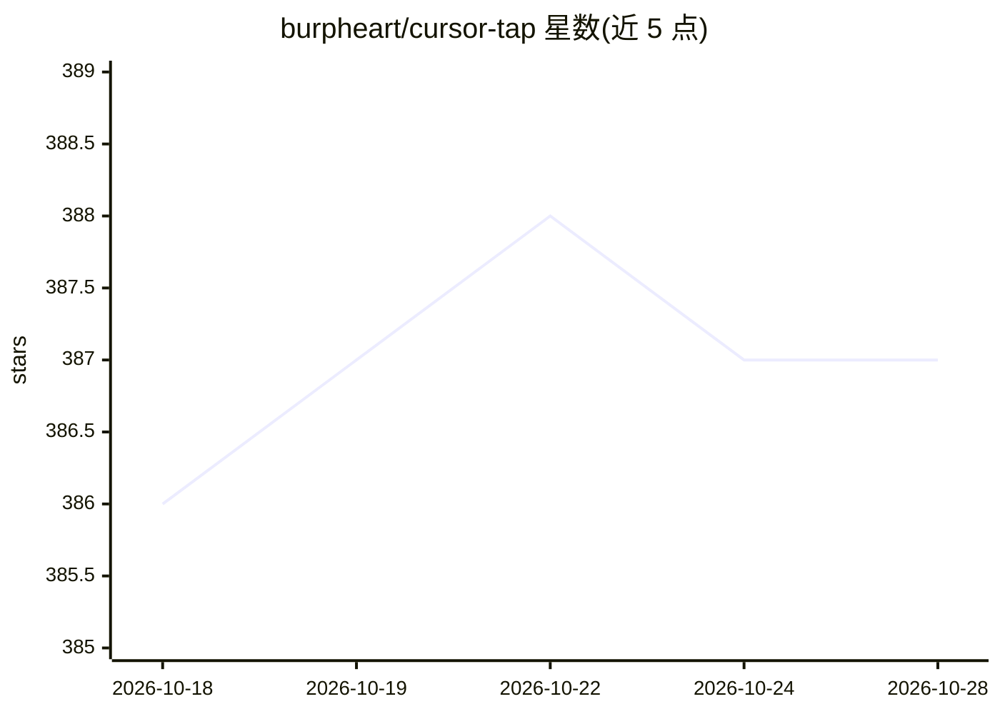

# burpheart/cursor-tap

⭐ 387 · Go · 推送 2026-03-15 · [GitHub](https://github.com/burpheart/cursor-tap) · 个人维护 · 中文 README

**Cursor IDE gRPC 中间人流量分析工具，解密并实时展示 AI 对话 RPC**

Go 编写的 MITM 代理与 WebUI：在 Cursor 客户端与 api2.cursor.sh 之间插入代理层，用首次启动自动生成的自签 CA 解密 TLS；从 Cursor 客户端 JS 代码（protobuf-es 编译产物）提取 proto 定义，解析 Connect Protocol 的 envelope framing 并反序列化每帧 protobuf，转为可读 JSON。WebSocket 实时推送到前端，四栏布局展示服务树、调用列表、帧列表与详情，可观察 AI 对话主通道、代码补全、行为上报等几十个 RPC 方法。安装需 go run 启动代理、npm 运行 WebUI，并配置 Cursor 环境变量走代理。

## 筛选速览

| 维度 | 判定 | 备注 |
|---|---|---|
| AI 角色 | `ai-ecosystem` | LLM/agent 周边工具 |
| 许可风险 | `none` | — |
| 部署形态 | `library` | 以包/库形式分发 |
| 模型依赖 | — | README 未给出锁定关系 |
| 硬件要求 | — | 无带数字的原话,不猜 |
| 安装摩擦 | `low` | 无编译、无系统依赖或容器化 |
| 成熟度 | — | 结构信号不足 |

## 能力要点

- 自签 CA 动态签发，解密 Cursor 与 api2.cursor.sh 的 gRPC/TLS 流量
- 从客户端 JS 提取 proto 定义，反序列化 Connect Protocol protobuf 帧
- WebSocket 实时推送，四栏 WebUI 展示服务树/调用/帧/详情
- 覆盖 AiService/RunSSE、StreamCpp 等几十个 RPC 方法

## 适用场景

- 逆向分析 Cursor AI 对话与代码补全的通信协议
- 实时观察 AI streaming 每一帧的请求与响应内容
- 研究 Cursor 客户端行为上报机制

## 场景标签

 · 领域:开发者工具/流量分析

## 证据(README 行号)

> L5: Cursor IDE gRPC 中间人流量分析工具。可以解密 TLS、反序列化 protobuf、实时展示 AI 对话产生的RPC请求和响应。
> L70: - `AiService/RunSSE`：AI 对话的主通道，包括 AI 思考、文本生成、工具调用

## 星数曲线

2026-10-18 386 → 2026-10-28 387（+1）

---
*卡片 v1 · prompt 1.4 · 生成 2026-10-21 · 置信度 mid · 依据 README sha `18353b4052b3` · [字段定义](../../DATASET.md)*
