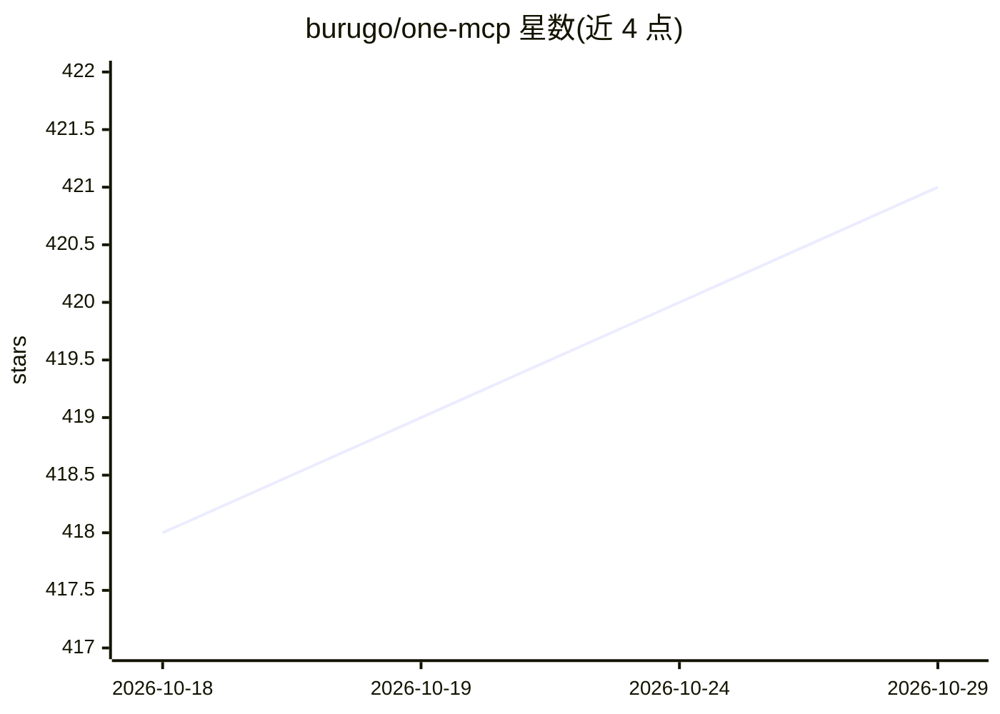

# burugo/one-mcp

⭐ 421 · Go · MIT · 推送 2026-09-06 · [GitHub](https://github.com/burugo/one-mcp) · 个人维护 · 中文 README

**MCP 服务集中反向代理平台：统一管理、分组并导出为 Skills**

用 Go 与 React 构建的 Model Context Protocol (MCP) 服务集中代理与管理平台：从市场或自定义来源安装、配置、监控 stdio/SSE/streamable HTTP 类型的 MCP 服务；可将多个 MCP 服务组合为服务组、聚合为单一端点，并导出为 Anthropic Skills 供 Claude Code 使用。提供使用量/请求率/响应时间分析、多用户与 OAuth 登录（GitHub/Google）、SQLite/MySQL/PostgreSQL 存储与可选 Redis。支持 Homebrew、Docker 与源码构建部署，提供 RESTful API 与中英文界面。默认登录 root/123456。

## 筛选速览

| 维度 | 判定 | 备注 |
|---|---|---|
| AI 角色 | `ai-ecosystem` | LLM/agent 周边工具 |
| 许可风险 | `permissive` | MIT |
| 部署形态 | `self-host` | docker 或自建部署 |
| 模型依赖 | — | README 未给出锁定关系 |
| 硬件要求 | — | 无带数字的原话,不猜 |
| 安装摩擦 | `low` | 无编译、无系统依赖或容器化 |
| 成熟度 | — | 结构信号不足 |

## 能力要点

- 集中代理管理 stdio/SSE/streamable HTTP 三类 MCP 服务
- 服务组聚合多服务为单一端点并导出为 Anthropic Skills
- 实时使用分析（请求率、响应时间、系统健康）
- 多用户角色访问控制与 GitHub/Google OAuth 登录

## 适用场景

- 把多个 MCP 服务聚合成一个端点统一接入
- 在 Web 界面安装与监控 MCP 服务的运行状况
- 将 MCP 服务组导出为 Claude Code 可用的 Skills

## 场景标签

`模型网关` · 领域:Agent 开发

## 证据(README 行号)

> L27: One MCP is a comprehensive management platform for Model Context Protocol (MCP) services. Acting as a centralized p
> L33: - **Service Management** — Install, configure, and monitor MCP services (stdio / SSE / streamable HTTP) from a mark
> L34: - **Service Groups** — Combine multiple MCP services into a single endpoint; export as Anthropic Skills for Claude 

## 星数曲线

2026-10-18 418 → 2026-10-29 421（+3）

---
*卡片 v1 · prompt 1.4 · 生成 2026-10-21 · 置信度 high · 依据 README sha `4a56a3e9d8d2` · [字段定义](../../DATASET.md)*
