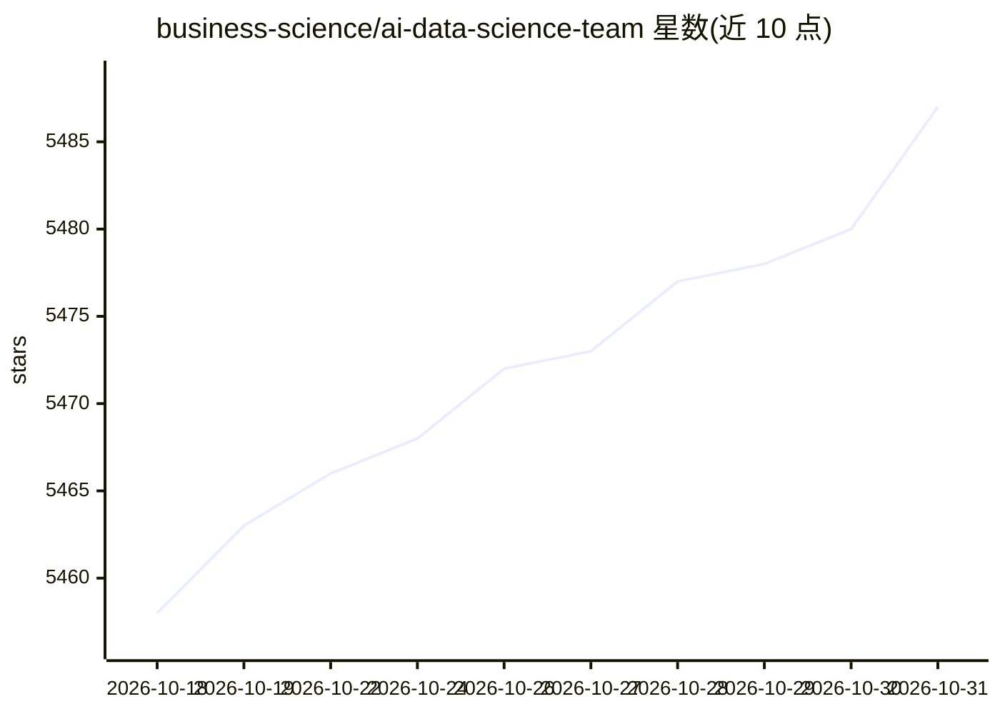

# business-science/ai-data-science-team

⭐ 5,487 · Python · MIT · 推送 2026-01-28 · [GitHub](https://github.com/business-science/ai-data-science-team) · 组织维护

**面向数据科学工作流的多智能体 Python 库与可视化 Pipeline 应用**

包含两部分：AI Data Science Team 库提供数据科学各环节的专用 agent 构建模块与多 agent 工作流（数据加载、清洗、特征工程、可视化、EDA、SQL、H2O 建模、MLflow 工具及 Supervisor 监督 agent）；旗舰应用 AI Pipeline Studio 是 Streamlit 应用，把上述 agent 组合为可视化、可复现的流水线，支持手动与 AI 步骤、多数据集合并、项目保存与重水化。LLM 后端经 LangChain 接入 OpenAI 或本地 Ollama。状态为 Beta，0.1.0 前可能出现破坏性变更。

## 筛选速览

| 维度 | 判定 | 备注 |
|---|---|---|
| AI 角色 | `ai-ecosystem` | LLM/agent 周边工具 |
| 许可风险 | `permissive` | MIT |
| 部署形态 | `library` | 以包/库形式分发 |
| 模型依赖 | local-ok | 支持本地模型 |
| 硬件要求 | — | 无带数字的原话,不猜 |
| 安装摩擦 | `low` | 无编译、无系统依赖或容器化 |
| 成熟度 | `idea` | |

## 能力要点

- 覆盖数据加载/清洗/EDA/建模/SQL/MLflow 的专用 agent 与多 agent 工作流
- AI Pipeline Studio 提供可视化编辑器与可复现流水线、血缘追踪
- 支持 OpenAI API 与 Ollama 本地模型两种 LLM 后端
- Supervisor Agent 监督其他 agent 协同工作

## 适用场景

- 用多 agent 流水线完成数据清洗到建模的数据科学流程
- 在可视化界面中混合手动与 AI 步骤做探索性分析
- 本地 Ollama 模型驱动离线数据分析工作流

## 场景标签

`Agent 框架` `多智能体` `数据分析` · 领域:Agent 开发

## 证据(README 行号)

> L16: AI Data Science Team is a Python library of specialized agents for common data science workflows, plus a flagship a
> L61: The repository includes both the **AI Pipeline Studio** app and the underlying **AI Data Science Team** library. Th

## 星数曲线

2026-10-18 5,458 → 2026-10-31 5,487（+29）

---
*卡片 v1 · prompt 1.4 · 生成 2026-10-20 · 置信度 high · 依据 README sha `516ec932755a` · [字段定义](../../DATASET.md)*
