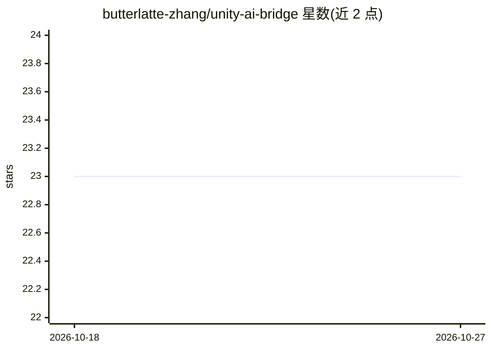

# butterlatte-zhang/unity-ai-bridge

⭐ 23 · C# · Apache-2.0 · 推送 2026-03-25 · [GitHub](https://github.com/butterlatte-zhang/unity-ai-bridge) · 个人维护 · 中文 README

**让 AI IDE 远程操控 Unity 编辑器的 MCP/CLI 桥接工具**

由 Unity 插件与纯 Python stdlib 的 CLI/MCP 服务器组成，通过磁盘上的请求/响应文件做 IPC（无网络端口），把 Unity 编辑器能力以 65 个工具、15 类（场景、GameObject、资源、Profiler、光照探针、运行时查询、测试等）暴露给 Claude Code、Cursor、GitHub Copilot、Windsurf 等 AI IDE。支持进入/退出 Play Mode、运行时调用与截图，构成 AI 写代码→编译→测试→修复的闭环；可用 [BridgeTool] 属性以数行代码扩展自定义工具。要求 Unity 2022.3+，支持 Windows/macOS。

## 筛选速览

| 维度 | 判定 | 备注 |
|---|---|---|
| AI 角色 | `ai-ecosystem` | LLM/agent 周边工具 |
| 许可风险 | `permissive` | Apache-2.0 |
| 部署形态 | `library` | 以包/库形式分发 |
| 模型依赖 | — | README 未给出锁定关系 |
| 硬件要求 | — | 无带数字的原话,不猜 |
| 安装摩擦 | `low` | 无编译、无系统依赖或容器化 |
| 成熟度 | — | 结构信号不足 |

## 能力要点

- 65 个工具覆盖场景/资源/Profiler/光照探针/测试等 15 类编辑器工作流
- 文件 IPC 双通道设计（Skill 直连 CLI 与 MCP 协议），无端口、无防火墙问题
- 运行时查询/调用+截图构成 AI 自动 Playtest 闭环
- [BridgeTool] 属性反射自动发现自定义工具，零注册代码

## 适用场景

- 让 Claude Code/Cursor 等 AI 助手直接检查和修改 Unity 场景与资源
- AI 闭环自动测试：写代码→进 Play Mode→观察状态→判断→修复
- 在 Unity 2022.3 LTS 项目中用 AI 执行 Profiler 快照与热点分析

## 场景标签

`编码 Agent` · 领域:编码与开发

## 证据(README 行号)

> L22: - **File-based IPC, not WebSocket** — No open ports, no firewall issues, no connection drops. Survives recompilatio
> L24: - **Every major AI IDE** — Claude Code (Skill mode), Cursor, GitHub Copilot, Windsurf, Claude Desktop (MCP mode). O
> L94: **Dual-channel design**: The same Unity plugin serves both Skill mode (direct CLI) and MCP mode (protocol server). 

## 星数曲线

2026-10-18 23 → 2026-10-27 23（+0）

---
*卡片 v1 · prompt 1.4 · 生成 2026-10-27 · 置信度 mid · 依据 README sha `30666e4b7347` · [字段定义](../../DATASET.md)*
