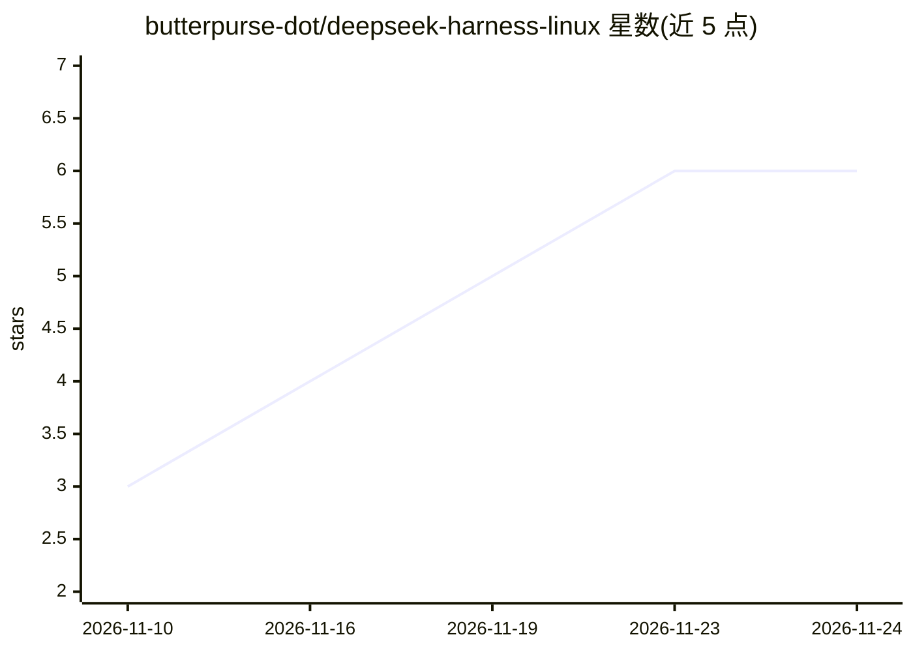

# butterpurse-dot/deepseek-harness-linux

⭐ 6 · TypeScript · MIT · 推送 2026-11-15 · [GitHub](https://github.com/butterpurse-dot/deepseek-harness-linux) · [官网](https://butterpurse-dot.github.io/deepseek-harness-linux/) · 个人维护

**为 DeepSeek Harness 桌面版提供社区 Linux 打包发布**

官方 DeepSeek Harness 桌面应用仅覆盖 macOS 与 Windows，该仓库是下游社区分支，增加 Linux 发布目标：发布 AppImage、deb、rpm、tar.gz 四种格式，覆盖 x64 与 arm64 架构，每版附 SHA256SUMS 校验文件。AppImage 经 electron-updater 与 GitHub Releases 实现自动更新，并提供 dsh-update 终端更新命令；计划任务每小时同步上游、rebase 并自动发布。维护方声明为尽力而为的社区构建，无 SLA。

## 筛选速览

| 维度 | 判定 | 备注 |
|---|---|---|
| AI 角色 | `ai-ecosystem` | LLM/agent 周边工具 |
| 许可风险 | `permissive` | MIT |
| 部署形态 | `desktop` | 安装包/桌面程序 |
| 模型依赖 | locked-api |  |
| 硬件要求 | — | 无带数字的原话,不猜 |
| 安装摩擦 | `low` | 无编译、无系统依赖或容器化 |
| 成熟度 | — | 结构信号不足 |

## 能力要点

- 四种打包格式（AppImage/deb/rpm/tar.gz）覆盖 x64 与 arm64
- AppImage 自动更新与 dsh-update 校验更新命令
- 每小时上游同步工作流，失败时自动开 issue 并保留上个可用版本
- 内置 Node/pnpm/Python 运行时，无需系统安装 Node

## 适用场景

- 在 Fedora/RHEL 等发行版上通过 rpm 安装 DeepSeek Harness 桌面版
- 在 arm64 Linux 设备上运行官方桌面应用
- 需要自动更新和校验和验证的 Linux 桌面部署

## 场景标签

 · 领域:AI 桌面应用的发行/打包

## 证据(README 行号)

> L15: Community Linux packaging for the official DeepSeek Harness desktop app. This is a downstream fork, not an official
> L17: The upstream desktop app is packaged for macOS and Windows only. This fork adds a Linux release target and publishe
> L73: - The official Electron desktop application (`apps/desktop`), unmodified except for the Linux target wiring and des

## 星数曲线

2026-11-10 3 → 2026-11-24 6（+3）

---
*卡片 v1 · prompt 1.4 · 生成 2026-11-21 · 置信度 high · 依据 README sha `dd2353f76f74` · [字段定义](../../DATASET.md)*
