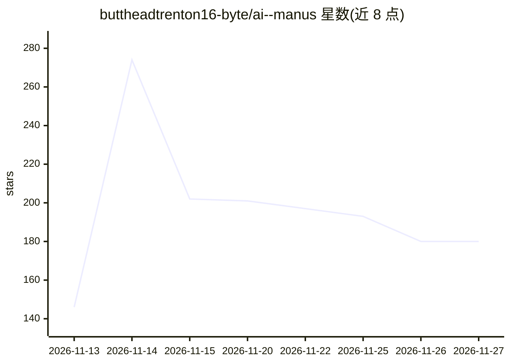

# buttheadtrenton16-byte/ai--manus

⭐ 180 · Apache-2.0 · 推送 2026-11-15 · [GitHub](https://github.com/buttheadtrenton16-byte/ai--manus) · 个人维护

**面向日常任务的自主 AI Agent：代用户运行代码与控制浏览器**

README 以功能宣传为主的自称为 Manus 的自主 AI Agent：描述其可代用户编写并执行脚本、打开网页与页面元素交互、执行多步骤任务，并可在脚本与浏览器操作间衔接流程。定位为面向家庭、学习与轻量办公场景的小型助手，而非企业平台。页面给出下载入口与兼容性表（最低 4GB 内存、双核 CPU）。README 未包含仓库代码结构、安装命令或模型接入方式等可验证细节，主题标签含 OpenAI/Anthropic/Gemini 等词。

## 筛选速览

| 维度 | 判定 | 备注 |
|---|---|---|
| AI 角色 | `ai-native` | 本体是模型或模型工具 |
| 许可风险 | `permissive` | Apache-2.0 |
| 部署形态 | `None` |  |
| 模型依赖 | — | README 未给出锁定关系 |
| 硬件要求 | — | 无带数字的原话,不猜 |
| 安装摩擦 | `low` | 无编译、无系统依赖或容器化 |
| 成熟度 | — | 结构信号不足 |

## 能力要点

- 自主编写并执行代码完成任务的 Agent
- 浏览器控制：导航网页、填写表单、采集信息
- 脚本与浏览器操作衔接的多步骤任务流
- 跨会话记忆工作流模式

## 适用场景

- 让 Agent 代为收集网页资料并整理摘要
- 跑小型脚本实验和快速计算
- 处理文件检查、表单填写等重复性杂务

## 场景标签

`浏览器自动化` `编码 Agent` `AI 助手` · 领域:效率与自动化

## 证据(README 行号)

> L10: - **Autonomous Code Execution:** Manus AI agent runs code on its own to complete tasks, so you can focus on decisio
> L18: Manus is an autonomous AI agent designed to run code and control a browser on your behalf. Instead of acting like a

## 星数曲线

2026-11-13 146 → 2026-11-27 180（+34）

---
*卡片 v1 · prompt 1.4 · 生成 2026-11-17 · 置信度 low · 依据 README sha `fbfd5e977bf4` · [字段定义](../../DATASET.md)*
