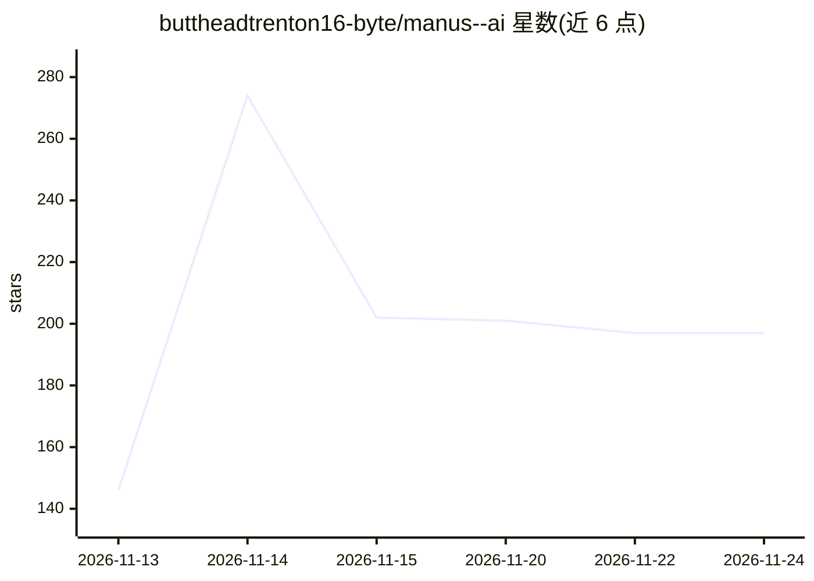

# buttheadtrenton16-byte/manus--ai

⭐ 193 · Apache-2.0 · 推送 2026-11-15 · [GitHub](https://github.com/buttheadtrenton16-byte/manus--ai) · 个人维护

**面向个人用户的自主 AI Agent：代跑代码并操控浏览器**

README 描述的 Manus 是一个自主执行任务的 AI agent：用户以自然语言下达指令，agent 编写并执行脚本、控制浏览器（导航页面、填写表单、抓取信息），并可跨代码与浏览器完成多步任务。定位为家庭、学习与轻度办公场景的个人助手，而非企业平台。README 未给出具体的模型接入方式、安装命令或代码仓库内容，仅描述功能、硬件兼容表（最低 4 GB 内存）与使用流程，技术实现细节无法从可见文本核实。

## 筛选速览

| 维度 | 判定 | 备注 |
|---|---|---|
| AI 角色 | `ai-native` | 本体是模型或模型工具 |
| 许可风险 | `permissive` | Apache-2.0 |
| 部署形态 | `None` |  |
| 模型依赖 | — | README 未给出锁定关系 |
| 硬件要求 | — | 无带数字的原话,不猜 |
| 安装摩擦 | `low` | 无编译、无系统依赖或容器化 |
| 成熟度 | — | 结构信号不足 |

## 能力要点

- 自主编写并执行代码完成任务的 agent
- 浏览器控制：导航、填表、采集信息
- 代码与浏览器动作可在同一多步流程中衔接

## 适用场景

- 让 agent 代为查网页、填表和采集信息
- 组织研究笔记、跑小脚本等日常杂务
- 远程协助时快速整理诊断步骤

## 场景标签

`AI 助手` `浏览器自动化` `编码 Agent` · 领域:效率与自动化

## 证据(README 行号)

> L18: Manus is an autonomous AI agent designed to run code and control a browser on your behalf. Instead of acting like a
> L22: Manus is not a heavy studio suite or a complex enterprise platform. It is a focused helper built for home, study, a

## 星数曲线

2026-11-13 146 → 2026-11-24 197（+51）

---
*卡片 v1 · prompt 1.4 · 生成 2026-11-17 · 置信度 low · 依据 README sha `0f78ee3a5dd2` · [字段定义](../../DATASET.md)*
