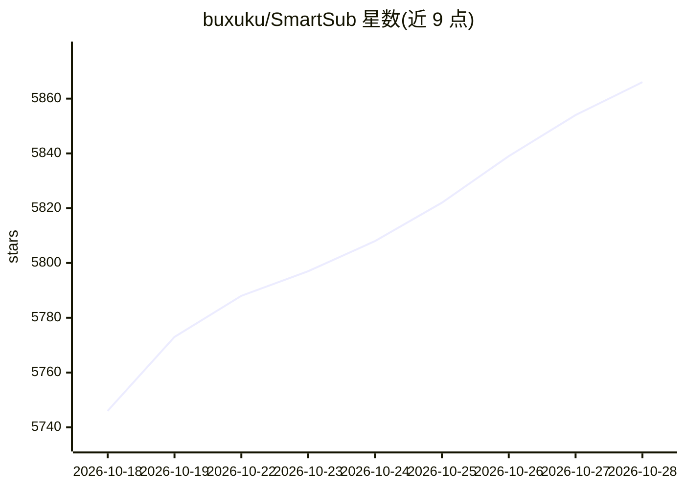

# buxuku/SmartSub

⭐ 5,866 · TypeScript · MIT · 推送 2026-10-26 · [GitHub](https://github.com/buxuku/SmartSub) · [官网](https://smartsub.linxiaodong.com/) · 个人维护 · 中文 README

**一站式桌面工具：视频转字幕、翻译、AI 配音与声音克隆、烧录**

开源桌面应用，把「在线/本地视频下载 → 语音转写 → 字幕翻译 → 校对 → TTS 配音 → 字幕烧录」整条流水线装进一个应用。转写支持 whisper.cpp、faster-whisper、FunASR、Qwen3-ASR、FireRedASR、NVIDIA Parakeet 等 8 类引擎，本地引擎离线运行、文件不出本机；配音含本地 Kokoro/VITS 与 ZipVoice 零样本声音克隆。另内置 AI 创作助手（多模型接入、截图诊断、工具调用）与 111 个 MCP 工具/CLI 命令供 Cursor、Claude Code 等外部 Agent 调度。支持 NVIDIA/AMD/Intel/Apple Silicon GPU 加速，付费云服务均为可选。

## 筛选速览

| 维度 | 判定 | 备注 |
|---|---|---|
| AI 角色 | `ai-native` | 本体是模型或模型工具 |
| 许可风险 | `permissive` | MIT |
| 部署形态 | `None` |  |
| 模型依赖 | local-ok | 支持本地模型 |
| 硬件要求 | — | 无带数字的原话,不猜 |
| 安装摩擦 | `medium` | 含编译或系统依赖之一 |
| 成熟度 | — | 结构信号不足 |

## 能力要点

- 8 类转写引擎（whisper.cpp/FunASR/Qwen3-ASR 等），本地离线处理
- 20 个翻译服务与 6 类云端配音可选，全流程可免费本地跑通
- 本地 Kokoro/VITS TTS 与 ZipVoice 零样本声音克隆
- 111 个 MCP 工具与 CLI 命令，供 Cursor/Claude Code/脚本自动化调度

## 适用场景

- 给外语视频、公开课批量生成双语字幕
- 用自己的声音零样本克隆为视频配音
- 视频出海制作多语言音轨并烧录字幕
- 通过 MCP/CLI 让外部 AI Agent 全自动跑音视频流水线

## 场景标签

`语音识别` `语音合成` `图像视频处理` · 领域:内容生成

## 证据(README 行号)

> L40: 妙幕（SmartSub）是一款开源的音视频字幕与配音工具，把「语音转文字 → 字幕翻译 → 校对润色 → TTS 配音 → 烧录合成」整条流水线装进一个桌面应用，还内置在线视频下载，粘贴 B 站 / YouTube 等平台链接即可
> L95: - 8 类转写引擎逐任务切换：内置 `whisper.cpp`、`faster-whisper`、`FunASR`、`Qwen3-ASR`、`FireRedASR`、`NVIDIA Parakeet`、本地 `Whisper CL
> L124: - 本地引擎离线免费：Kokoro 多语 103 音色、VITS 中文 174 音色

## 星数曲线

2026-10-18 5,746 → 2026-10-28 5,866（+120）

---
*卡片 v1 · prompt 1.4 · 生成 2026-10-20 · 置信度 high · 依据 README sha `3e9cd377f048` · [字段定义](../../DATASET.md)*
