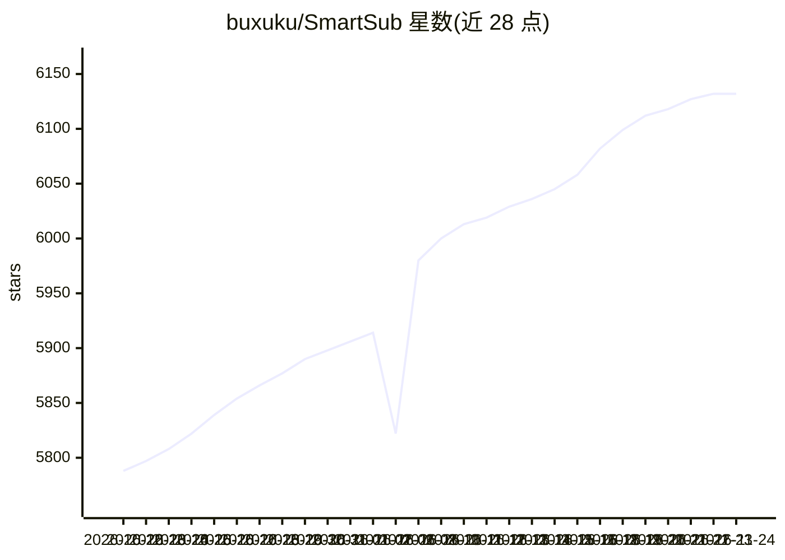

# buxuku/SmartSub

⭐ 6,140 · TypeScript · MIT · 推送 2026-11-19 · [GitHub](https://github.com/buxuku/SmartSub) · [官网](https://smartsub.linxiaodong.com/) · 个人维护 · 中文 README

**给视频创作者/内容团队：本地离线转写、翻译、配音与烧录字幕的桌面工具**

妙幕（SmartSub）是一个开源桌面应用，覆盖「语音转文字→字幕翻译→校对→TTS 配音→烧录合成」流水线，另内置在线视频下载。转写基于 whisper.cpp、faster-whisper、FunASR、sherpa-onnx 等本地模型离线运行，翻译提供 20 个服务（含免费接口与本地 Ollama），本地 TTS 含零样本声音克隆；支持批量处理与 NVIDIA/AMD/Intel/Apple 硬件加速，跨 Windows/macOS/Linux。内置 AI 创作助手，并提供 111 个 MCP 工具与 smartsub CLI 供外部 Agent 或脚本调度。

## 筛选速览

| 维度 | 判定 | 备注 |
|---|---|---|
| AI 角色 | `ai-native` | 本体是模型或模型工具 |
| 许可风险 | `permissive` | MIT |
| 部署形态 | `desktop` | 安装包/桌面程序 |
| 模型依赖 | local-ok | 支持本地模型 |
| 硬件要求 | — | 无带数字的原话,不猜 |
| 安装摩擦 | `medium` | 含编译或系统依赖之一 |
| 成熟度 | — | 结构信号不足 |

## 能力要点

- 8 类转写引擎逐任务切换，本地引擎完全离线
- 20 个翻译服务 + 6 类云端配音，全流程可免费跑通（无需 API Key）
- 111 个 MCP 工具与 CLI 命令，Cursor/Claude Code 一键接入
- GPU 加速包应用内下载，失败自动回退 CPU

## 适用场景

- 给无字幕的外语视频或公开课批量生成并翻译双语字幕
- 录制课程/播客/会议录音后批量转写成 SRT 存档
- 把字幕翻译后用 TTS 配成外语音轨做视频出海
- 用自己的声音零样本克隆配音整条视频

## 场景标签

`语音识别` `语音合成` `图像视频处理` · 领域:内容生成

## 证据(README 行号)

> L56: 妙幕（SmartSub）是一款开源的音视频字幕与配音工具，把「语音转文字 → 字幕翻译 → 校对润色 → TTS 配音 → 烧录合成」整条流水线装进一个桌面应用，还内置在线视频下载，粘贴 B 站 / YouTube 等平台链接即可
> L111: - 8 类转写引擎逐任务切换：内置 `whisper.cpp`、`faster-whisper`、`FunASR`、`Qwen3-ASR`、`FireRedASR`、`NVIDIA Parakeet`、本地 `Whisper C
> L63: **整条流水线可以完全免费跑通**：本地模型转写、内置免费翻译源、本地 TTS 配音（含声音克隆）、本地 ffmpeg 烧录——不需要 API Key，本地环节也没有用量限制。同时可按需接入 20 个翻译服务、9 家云端听写、6 

## 星数曲线

2026-10-22 5,788 → 2026-11-24 6,132（+344）

---
*卡片 v1 · prompt 1.4 · 生成 2026-11-22 · 置信度 high · 依据 README sha `7d3cee53050c` · [字段定义](../../DATASET.md)*
