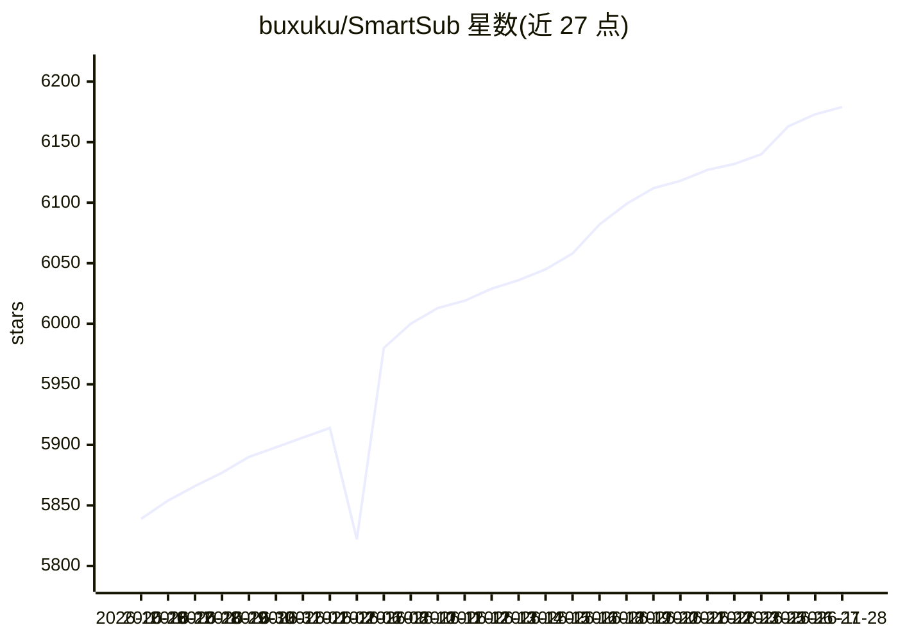

# buxuku/SmartSub

⭐ 6,179 · TypeScript · MIT · 推送 2026-11-25 · [GitHub](https://github.com/buxuku/SmartSub) · [官网](https://smartsub.linxiaodong.com/) · 个人维护 · 中文 README

**给视频创作者的一站式离线字幕生成、翻译、配音与烧录桌面工具**

基于 Electron 的跨平台桌面应用，覆盖「视频下载→转写→翻译→校对→TTS 配音→烧录合成」流水线。转写内置 whisper.cpp、faster-whisper、FunASR、Qwen3-ASR、FireRedASR、Parakeet 等本地引擎，完全离线；另内置 AI 创作助手（快捷键呼出、上下文感知、截图诊断、工具调用），并提供 111 个 MCP 工具与 smartsub CLI 供外部 Agent 与脚本调度。翻译接 20 个服务，配音支持本地 Kokoro/VITS 与 ZipVoice 零样本克隆。本地流水线无需 API Key；GPU 加速包在应用内按需下载。

## 筛选速览

| 维度 | 判定 | 备注 |
|---|---|---|
| AI 角色 | `ai-enhanced` | 去掉 AI 部分产品仍成立 |
| 许可风险 | `permissive` | MIT |
| 部署形态 | `desktop` | 安装包/桌面程序 |
| 模型依赖 | local-ok | 支持本地模型 |
| 硬件要求 | — | 无带数字的原话,不猜 |
| 安装摩擦 | `medium` | 含编译或系统依赖之一 |
| 成熟度 | — | 结构信号不足 |

## 能力要点

- 8 类转写引擎逐任务切换，本地模型离线处理、文件不出本机
- 111 个 MCP 工具与 CLI 命令，可由 Cursor、Claude Code 等外部 Agent 全自动调度
- 本地 TTS 与 ZipVoice 零样本声音克隆，免费路线无需 API Key
- NVIDIA CUDA / AMD·Intel Vulkan / Apple Core ML·Metal 加速，应用内下载加速包

## 适用场景

- 给无字幕的外语视频批量生成并翻译双语字幕
- 把播客、网课、会议录音批量转写成 SRT 存档
- 给自己的视频用克隆音色配外语配音并烧录导出
- 用脚本或 AI Agent 批量自动化音视频字幕流水线

## 场景标签

`语音识别` `语音合成` `图像视频处理` · 领域:内容生成

## 证据(README 行号)

> L56: 妙幕（SmartSub）是一款开源的音视频字幕与配音工具，把「语音转文字 → 字幕翻译 → 校对润色 → TTS 配音 → 烧录合成」整条流水线装进一个桌面应用，还内置在线视频下载，粘贴 B 站 / YouTube 等平台链接即可
> L63: **整条流水线可以完全免费跑通**：本地模型转写、内置免费翻译源、本地 TTS 配音（含声音克隆）、本地 ffmpeg 烧录——不需要 API Key，本地环节也没有用量限制。同时可按需接入 20 个翻译服务、9 家云端听写、6 
> L111: - 8 类转写引擎逐任务切换：内置 `whisper.cpp`、`faster-whisper`、`FunASR`、`Qwen3-ASR`、`FireRedASR`、`NVIDIA Parakeet`、本地 `Whisper C

## 星数曲线

2026-10-26 5,839 → 2026-11-28 6,179（+340）

---
*卡片 v1 · prompt 1.4 · 生成 2026-11-26 · 置信度 high · 依据 README sha `8a4767263953` · [字段定义](../../DATASET.md)*
