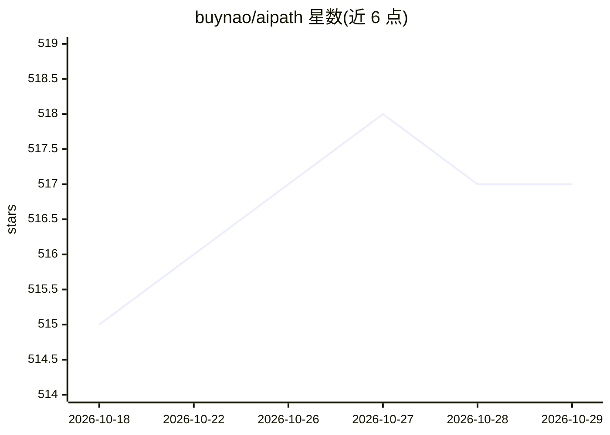

# buynao/aipath

⭐ 517 · JavaScript · 推送 2026-07-02 · [GitHub](https://github.com/buynao/aipath) · [官网](https://aipath.buynao.com) · 个人维护 · 中文 README

**零数学起点的 AI 通识互动课程：6 阶段 30 课，双语**

面向绝对初学者的 AI 通识课程网站，共 6 个阶段 30 课，从神经网络直觉讲到亲手构建 RAG 知识库。每课约 20 分钟，以 2D/3D 交互演示（调温度旋钮、拖动神经元权重、切分文档喂给 RAG）替代公式堆砌；末阶段写真实代码：调用 LLM API、在本机用 Ollama 运行开源模型、搭建 RAG 知识库并了解评估与安全红线。全部课程内容、演示与前端代码由 Claude Fable 生成，中英双语一键切换，无需注册，基于 Vite + React 构建。

## 筛选速览

| 维度 | 判定 | 备注 |
|---|---|---|
| AI 角色 | `ai-knowledge` | 知识聚合/清单类 |
| 许可风险 | `none` | — |
| 部署形态 | `library` | 以包/库形式分发 |
| 模型依赖 | — | README 未给出锁定关系 |
| 硬件要求 | — | 无带数字的原话,不猜 |
| 安装摩擦 | `low` | 无编译、无系统依赖或容器化 |
| 成熟度 | — | 结构信号不足 |

## 能力要点

- 6 阶段 30 课，覆盖直觉、深度学习原理、大模型、应用、前沿与动手实践
- 每个关键概念配 2D/3D/SVG/Canvas 交互演示，可亲手调参数
- 全部 30 课中英双语，站内一键切换无需刷新
- 课程内容与前端代码由 Claude Fable 端到端生成并在无头浏览器中逐课验证

## 适用场景

- 零基础系统入门 AI，靠交互演示建立直觉
- 从旁观者进阶到能自己搭建 RAG 应用与本地部署模型
- 中英双语学习与教学参考

## 场景标签

`教程课程` · 领域:学习与行业

## 证据(README 行号)

> L13: > A from-scratch AI course designed for absolute beginners — **6 stages, 30 lessons**. No piles of formulas, no jar
> L15: From "what is a neural network" to "building a RAG knowledge base with your own hands," this course takes you the w

## 星数曲线

2026-10-18 515 → 2026-10-29 517（+2）

---
*卡片 v1 · prompt 1.4 · 生成 2026-10-21 · 置信度 high · 依据 README sha `88a9cc75f745` · [字段定义](../../DATASET.md)*
