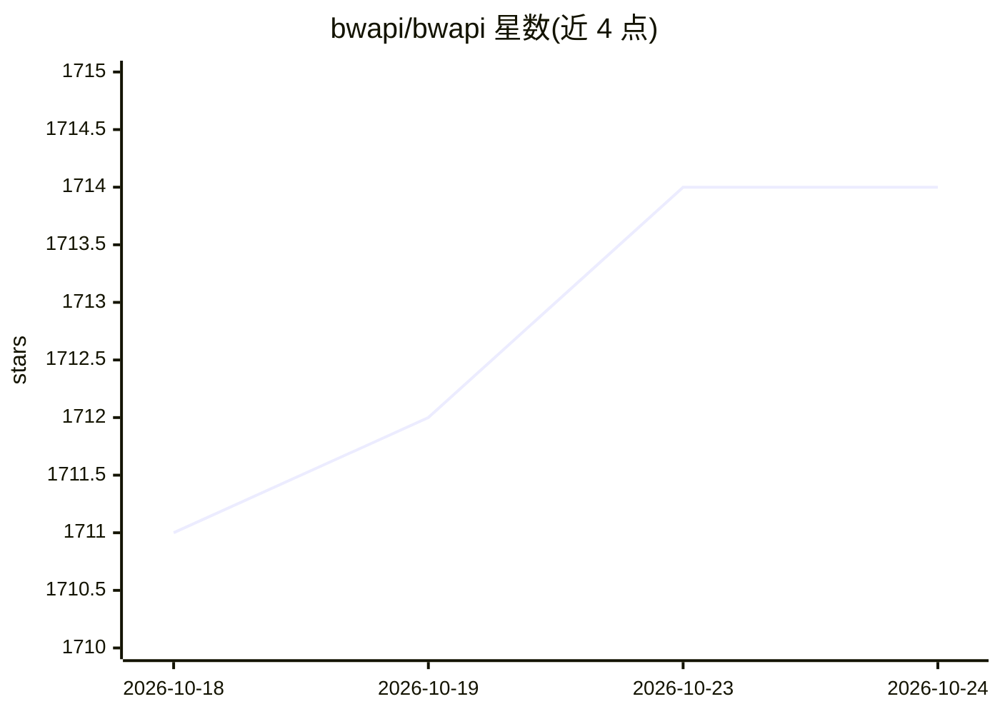

# bwapi/bwapi

⭐ 1,714 · C++ · LGPL-3.0 · 推送 2026-06-10 · [GitHub](https://github.com/bwapi/bwapi) · [官网](http://bwapi.github.io/) · 组织维护

**面向星际争霸的 C++ 框架：让学生和研究者开发游戏 AI**

开源 C++ 框架，用于与 RTS 游戏 Starcraft: Broodwar 交互，供学生、研究者与爱好者编写操控游戏的 AI agent。默认只向 AI 模块开放可见游戏状态，屏蔽战争迷雾中的信息并禁止用户输入，以支持编写非作弊的竞争型 AI；提供逐帧分析录像、读取单位/科技/武器数据等能力，并有 Tournament Module 作为 AI 竞赛裁判。安装依赖 Visual Studio 2017 与 1.16.1 版本的星际争霸，通过 Chaoslauncher 注入运行，支持 C++ 与 Java（教程）开发机器人。

## 筛选速览

| 维度 | 判定 | 备注 |
|---|---|---|
| AI 角色 | `ai-ecosystem` | LLM/agent 周边工具 |
| 许可风险 | `viral` | LGPL-3.0 |
| 部署形态 | `desktop` | 安装包/桌面程序 |
| 模型依赖 | — | README 未给出锁定关系 |
| 硬件要求 | — | 无带数字的原话,不猜 |
| 安装摩擦 | `low` | 无编译、无系统依赖或容器化 |
| 成熟度 | — | 结构信号不足 |

## 能力要点

- 默认只暴露可见游戏状态，支持非作弊 AI 开发
- 逐帧分析录像并提取策略、建造顺序等趋势
- Tournament Module 可强制执行规则，充当 AI 竞赛裁判
- 读取单位类型、升级、科技、武器等完整数据

## 适用场景

- 开发星际争霸 AI 机器人参加 AIIDE/CoG/SSCAIT 等竞赛
- 在商业 RTS 环境中研究实时 AI 算法
- 逐帧分析录像研究建造顺序与常见策略

## 场景标签

 · 领域:游戏 AI/机器人开发框架

## 证据(README 行号)

> L11: The Brood War Application Programming Interface (BWAPI) is a free and open source C++ framework that is
> L13: students, researchers, and hobbyists can create Artificial Intelligence (AI) agents that play the game.

## 星数曲线

2026-10-18 1,711 → 2026-10-24 1,714（+3）

---
*卡片 v1 · prompt 1.4 · 生成 2026-10-21 · 置信度 high · 依据 README sha `c6eecc4ecfde` · [字段定义](../../DATASET.md)*
