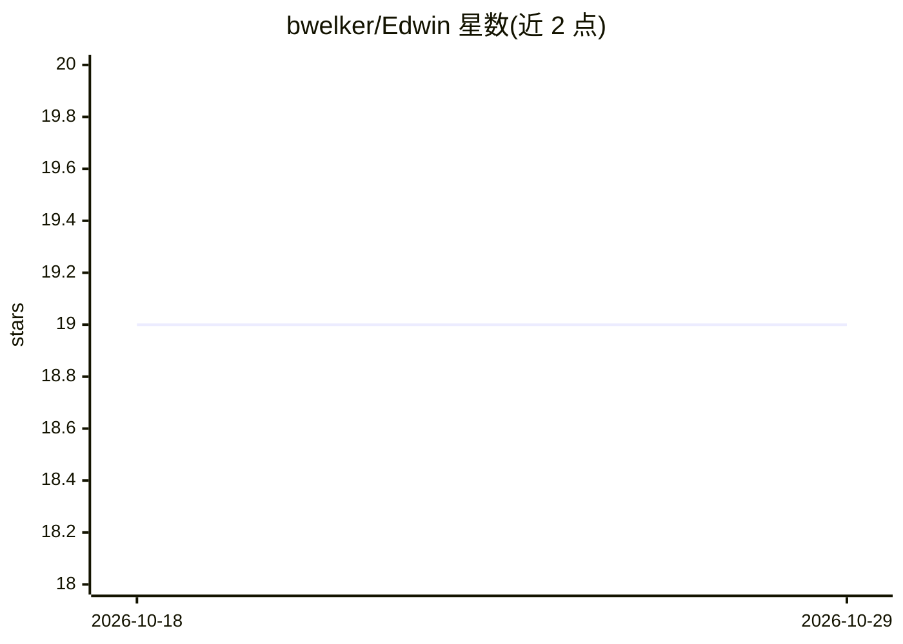

# bwelker/Edwin

⭐ 19 · Python · Apache-2.0 · 推送 2026-07-05 · [GitHub](https://github.com/bwelker/Edwin) · 个人维护

**给忙碌管理者的本地优先个人 AI 参谋长：接管日程与认知负担**

运行于 Claude Code 之上的个人 AI 助手：通过 15 个数据连接器（邮件、日历、iMessage、会议转录、浏览器历史等）把数字生活摄取为结构化 Markdown，经 Qdrant 向量化与 Neo4j 建立五层记忆（工作/情景/语义/前瞻/程序性），以 SKILL.md 形式存储技能，经 Plombery 调度生成晨报、追踪承诺、隔夜研究。本地优先运行于 macOS，需 Claude Code 订阅与 Docker；作者本人日常用于管理 40 人团队。

## 筛选速览

| 维度 | 判定 | 备注 |
|---|---|---|
| AI 角色 | `ai-native` | 本体是模型或模型工具 |
| 许可风险 | `permissive` | Apache-2.0 |
| 部署形态 | `None` |  |
| 模型依赖 | local-ok | 支持本地模型 |
| 硬件要求 | — | 无带数字的原话,不猜 |
| 安装摩擦 | `low` | 无编译、无系统依赖或容器化 |
| 成熟度 | — | 结构信号不足 |

## 能力要点

- 五层认知记忆架构与语义搜索覆盖全部个人数据
- 15 个数据连接器摄取邮件/日历/iMessage/会议转录等
- SKILL.md 纯 markdown 技能，可被任意 LLM 执行
- Plombery 调度 15+ 管道：晨报、隔夜研究、每周交付物

## 适用场景

- 每天早晨收到日程感知的优先级晨报
- 让 AI 基于完整上下文起草邮件、准备会议
- 隔夜自动运行研究并生成周报与幻灯片等交付物

## 场景标签

`AI 助手` `语义搜索` `AI 写作` · 领域:对话与助手

## 证据(README 行号)

> L12: Edwin is an AI assistant that runs your life. Not a chatbot. Not a framework. A persistent, memory-rich system desi
> L14: Built on Claude Code by Anthropic. Runs locally on your Mac. Your data stays on your machine.

## 星数曲线

2026-10-18 19 → 2026-10-29 19（+0）

---
*卡片 v1 · prompt 1.4 · 生成 2026-10-28 · 置信度 high · 依据 README sha `35a603ff25e6` · [字段定义](../../DATASET.md)*
