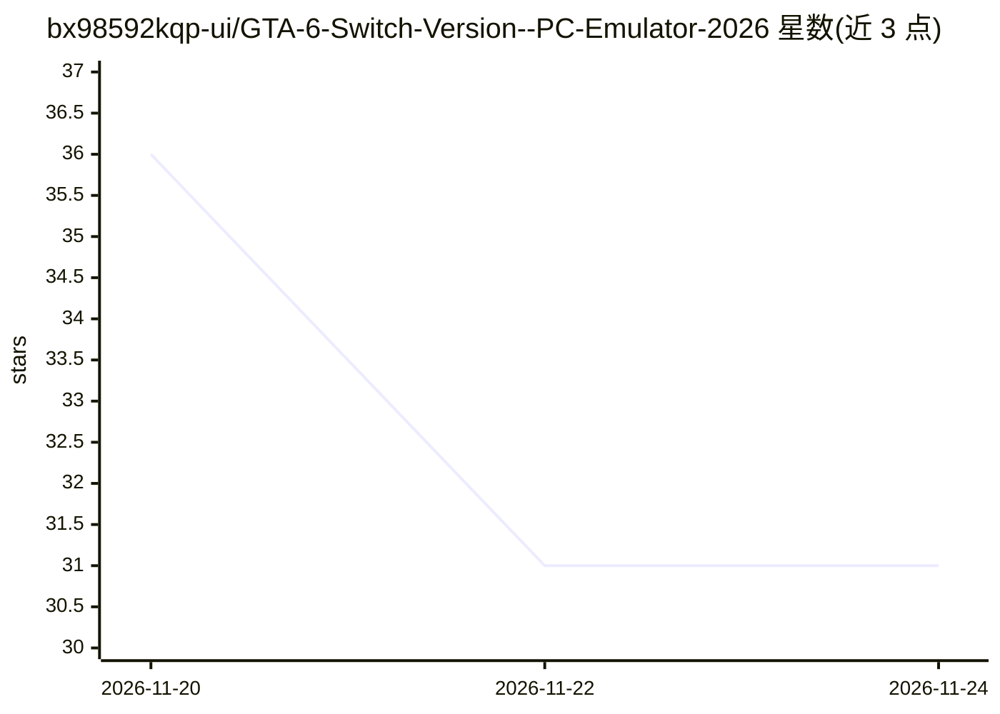

# bx98592kqp-ui/GTA-6-Switch-Version--PC-Emulator-2026

⭐ — · [GitHub]() · 个人维护

**面向 Windows 玩家的 GTA VI PC 安装准备与优化指南站点**

该仓库提供面向 Windows 10/11 用户的 Grand Theft Auto VI PC 版准备资料：Windows 环境检查、显卡驱动更新指引、存储检查、Rockstar Games Launcher 准备、图形设置与 FPS 排障说明。README 明确声明配套安装程序不包含或安装 GTA VI 游戏文件，游戏需通过授权渠道另行获取；官方 PC 配置要求尚未公布，表中各项均标注为未确认。

## 筛选速览

| 维度 | 判定 | 备注 |
|---|---|---|
| AI 角色 | `ai-knowledge` | 知识聚合/清单类 |
| 许可风险 | `permissive` | — |
| 部署形态 | `desktop` | 安装包/桌面程序 |
| 模型依赖 | — | README 未给出锁定关系 |
| 硬件要求 | — | 无带数字的原话,不猜 |
| 安装摩擦 | `low` | 无编译、无系统依赖或容器化 |
| 成熟度 | `idea` | |

## 能力要点

- 提供 Windows 兼容性检查清单（系统版本/DirectX/驱动/存储）
- 分步骤的 PC 准备指南（更新系统、GPU 驱动、启动器准备）
- FPS 与卡顿问题的通用排障条目
- README 声明配套安装程序不含游戏文件

## 适用场景

- 在 GTA VI PC 版发布前提前检查与准备 Windows 环境
- 查找显卡驱动更新与启动器配置的官方入口
- 排查 PC 游戏常见的低帧率与卡顿问题

## 场景标签

 · 领域:游戏/指南资源

## 证据(README 行号)

> L3: ### GTA 6 PC Installation, Setup & Performance Guide
> L19: The installation resource focuses on:
> L49: The companion installer does not contain or install GTA VI game files.

## 星数曲线

2026-11-20 36 → 2026-11-24 31（-5）

---
*卡片 v1 · prompt 1.4 · 生成 2026-11-22 · 置信度 mid · 依据 README sha `2fe487426686` · [字段定义](../../DATASET.md)*
