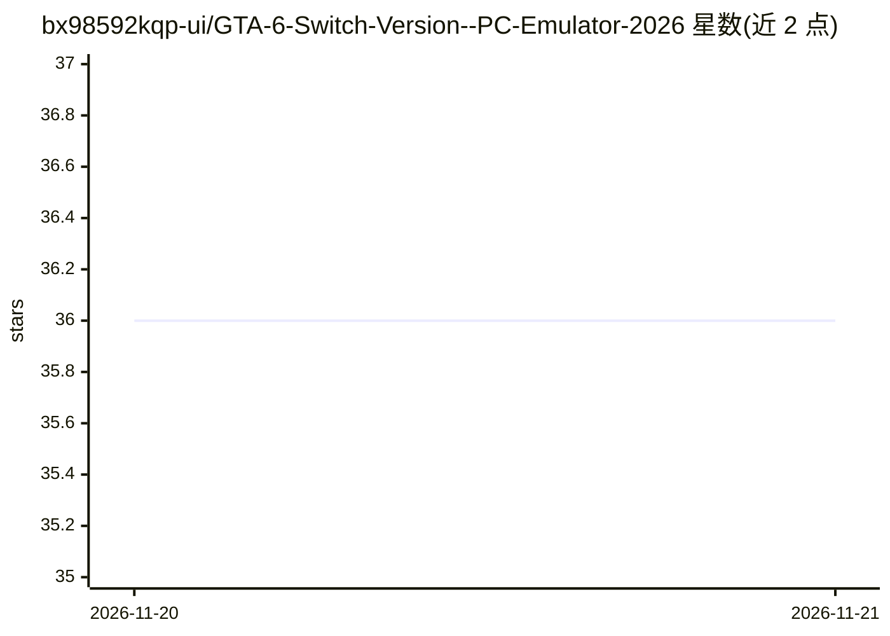

# bx98592kqp-ui/GTA-6-Switch-Version--PC-Emulator-2026

⭐ 36 · Go · Apache-2.0 · 推送 2026-11-19 · [GitHub](https://github.com/bx98592kqp-ui/GTA-6-Switch-Version--PC-Emulator-2026) · 个人维护

**GTA VI PC 版安装准备与优化指南及配套工具**

面向 Windows 10/11 用户的 GTA VI PC 版准备资源：提供 Windows 更新、GPU 驱动、存储与 Rockstar Games Launcher 的准备步骤，以及图形设置、FPS 排障、常见安装错误类别等文档内容。仓库另提供一个不含游戏文件的 Windows 安装包作为设置配套工具。官方 PC 配置要求尚未公布，文档中以 Not confirmed 表格占位，并声明设置将随官方信息更新。

## 筛选速览

| 维度 | 判定 | 备注 |
|---|---|---|
| AI 角色 | `ai-knowledge` | 知识聚合/清单类 |
| 许可风险 | `permissive` | Apache-2.0 |
| 部署形态 | `desktop` | 安装包/桌面程序 |
| 模型依赖 | — | README 未给出锁定关系 |
| 硬件要求 | — | 无带数字的原话,不猜 |
| 安装摩擦 | `low` | 无编译、无系统依赖或容器化 |
| 成熟度 | — | 结构信号不足 |

## 能力要点

- Windows/GPU 驱动/存储/启动器五步准备流程
- 图形设置与 FPS 排障文档（分辨率、阴影、光追、帧生成等）
- 提供不含游戏文件的 Windows .exe 配套安装包
- 系统需求表全部标注为未确认，待官方公布后更新

## 适用场景

- 在 GTA VI PC 版发布前提前准备 Windows 环境
- 排查 PC 游戏常见的低 FPS、卡顿与显示问题
- 查找 Rockstar 官方资源与启动器链接

## 场景标签

 · 领域:游戏/桌面工具

## 证据(README 行号)

> L5: A dedicated PC installation and configuration resource for Grand Theft Auto VI, covering Windows preparation, graphi
> L17: This repository is dedicated to Windows users preparing for the future PC edition of GTA VI.
> L49: The companion installer does not contain or install GTA VI game files.

## 星数曲线

2026-11-20 36 → 2026-11-21 36（+0）

---
*卡片 v1 · prompt 1.4 · 生成 2026-11-20 · 置信度 high · 依据 README sha `6954d37a13d3` · [字段定义](../../DATASET.md)*
