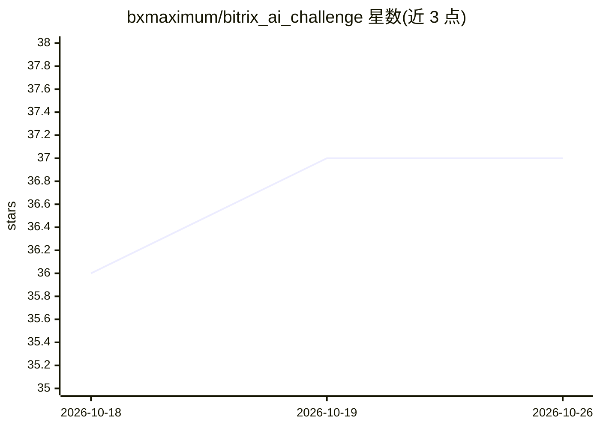

# bxmaximum/bitrix_ai_challenge

⭐ 37 · PHP · 推送 2026-10-14 · [GitHub](https://github.com/bxmaximum/bitrix_ai_challenge) · [官网](https://t.me/bxmaximum) · 组织维护

**AI 编程代理在 1С-Битрикс 开发任务上的对比基准与榜单**

由 BXMax 社区运行的基准挑战：各 agent 应用+模型组合在统一本地环境（Omut）上完成同一项真实 Bitrix 建站任务，由作者与模型评审按同一评分规则打分（视觉/后端各 0–100），形成分级榜单与逐次运行存档（run 元数据、反馈、代码、截图、判决）。仓库包含任务说明、评分规则、提交源码与第一版归档。面向关注 AI agent 在 PHP/Bitrix 开发能力的开发者。注意：单次运行、评分含人工因素。

## 筛选速览

| 维度 | 判定 | 备注 |
|---|---|---|
| AI 角色 | `ai-ecosystem` | LLM/agent 周边工具 |
| 许可风险 | `none` | — |
| 部署形态 | `None` |  |
| 模型依赖 | — | README 未给出锁定关系 |
| 硬件要求 | — | 无带数字的原话,不猜 |
| 安装摩擦 | `low` | 无编译、无系统依赖或容器化 |
| 成熟度 | — | 结构信号不足 |

## 能力要点

- 统一任务+统一环境（Omut）下的应用×模型×技能组合对比
- 双评审机制：模型评审（盲评、引用文件:行号）+ 作者实机评审
- 每次运行的完整存档：run.yaml、feedback、代码、截图、verdict
- 分级榜单（A/B/C/D tier）与迭代数、耗时、token 成本统计

## 适用场景

- 比较不同 agent 应用与模型在 Bitrix 开发任务上的表现
- 查看具体运行过程与评审细节以了解模型失败模式
- 参考 D7 开发相关的 AI 技能栈使用方式

## 场景标签

`模型评测` · 领域:评测与运维

## 证据(README 行号)

> L3: Бенчмарк AI-агентов на реальной задаче 1С-Битрикс. Тест на то, ведёт ли себя агент как битрикс-разработчик: развернё
> L57: Автопроверок нет — оценивают автор и модель по одной рубрике (harness/rubric.yaml):

## 星数曲线

2026-10-18 36 → 2026-10-26 37（+1）

---
*卡片 v1 · prompt 1.4 · 生成 2026-10-25 · 置信度 high · 依据 README sha `3c43f212fff8` · [字段定义](../../DATASET.md)*
