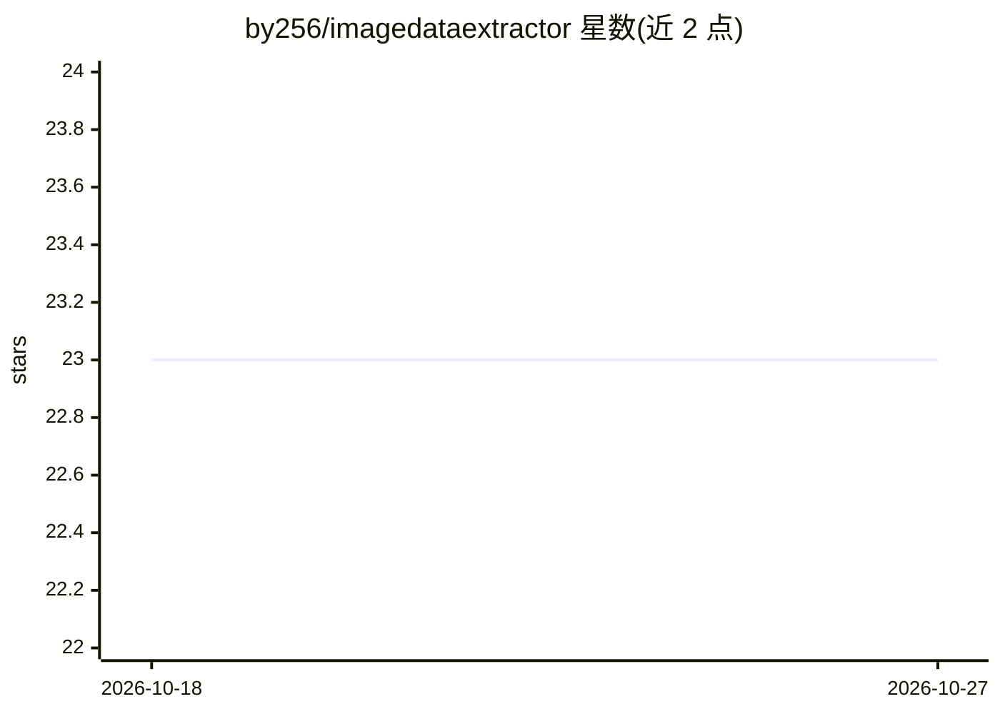

# by256/imagedataextractor

⭐ 23 · Python · MIT · 推送 2026-07-27 · [GitHub](https://github.com/by256/imagedataextractor) · [官网](https://imagedataextractor.org) · 个人维护

**纳米颗粒电镜图像定量分析库：分割、定位与尺度提取**

Python 库 imagedataextractor，面向电子显微镜纳米颗粒图像的量化：提供粒子分割（含不确定性量化）、粒子定位、比例尺自动检测与读取、粒径分布与径向分布函数计算，结果输出为 CSV；可从科学文献自动检测并下载显微图像，输入含多面板的图像时会自动拆分后逐图处理。需 Python 3.7+ 与系统级 Tesseract 4，推荐在虚拟环境安装，另提供在线 Demo。

## 筛选速览

| 维度 | 判定 | 备注 |
|---|---|---|
| AI 角色 | `ai-native` | 本体是模型或模型工具 |
| 许可风险 | `permissive` | MIT |
| 部署形态 | `library` | 以包/库形式分发 |
| 模型依赖 | — | README 未给出锁定关系 |
| 硬件要求 | — | 无带数字的原话,不猜 |
| 安装摩擦 | `low` | 无编译、无系统依赖或容器化 |
| 成熟度 | — | 结构信号不足 |

## 能力要点

- 带不确定性量化的粒子分割与粒子定位
- 比例尺自动检测（读取与测量）
- 粒径分布、长宽比与径向分布函数计算，结果输出 CSV
- 从科学文献自动检测并下载显微图像

## 适用场景

- 我对电镜图像中的纳米颗粒做尺寸分布统计
- 我需要批量处理文献中的显微图并提取粒子数据
- 我需要读取图像比例尺并得到带不确定性的分割结果

## 场景标签

`目标检测` `OCR` `科研工具` · 领域:学习与行业

## 证据(README 行号)

> L5: **imagedataextractor** is a Python library for nanoparticle electron microscopy image quantification.
> L12: - Particle segmentation with uncertainty quantification.

## 星数曲线

2026-10-18 23 → 2026-10-27 23（+0）

---
*卡片 v1 · prompt 1.4 · 生成 2026-10-27 · 置信度 high · 依据 README sha `6769a8e3f769` · [字段定义](../../DATASET.md)*
