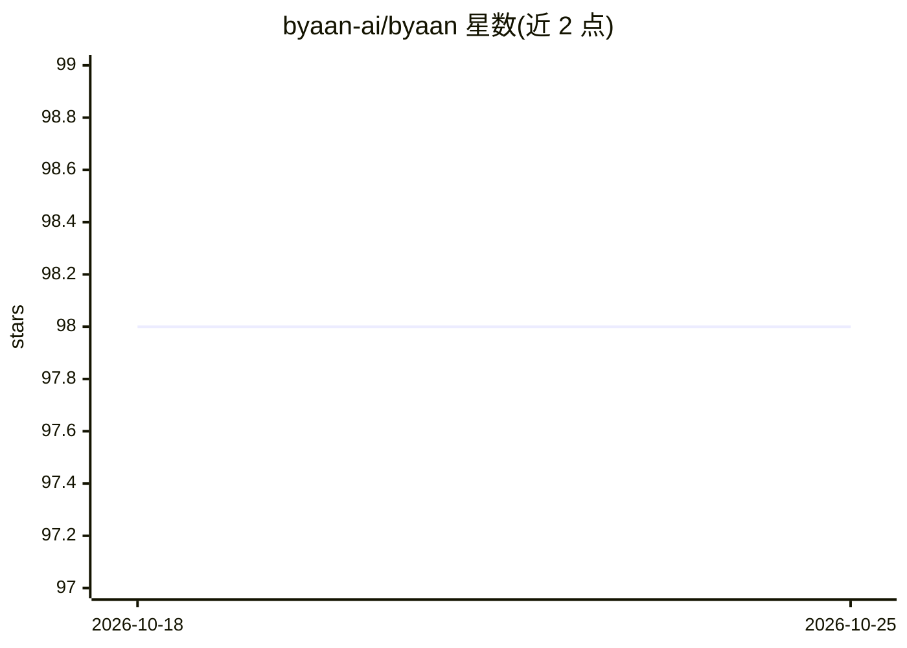

# byaan-ai/byaan

⭐ 98 · Python · MIT · 推送 2026-10-12 · [GitHub](https://github.com/byaan-ai/byaan) · [官网](https://www.byaan.ai/) · 组织维护

**自托管 AI 数据分析 agent：连自有数据库，自然语言出图表**

面向团队与个人开发者的 AI 数据分析 agent，连接 PostgreSQL、MongoDB、MySQL、SQLite、MSSQL、ODBC 及 CSV/Excel/Parquet/JSON 文件，用自然语言提问后生成可检查的查询、图表、仪表盘与定时报告。通过自动发现 schema、沉淀指标定义与业务规则来积累持久上下文，支持 BYO 模型（Claude/OpenAI/Bedrock/Groq 等）并暴露 MCP 接口供 Claude Code、Cursor 等工具调用。提供 Mac 原生应用与 Docker 自托管（社区版无内置认证，Team 版含 RBAC/Slack/HTTPS），查询流量不经过官方托管基础设施，带只读防护层拦截写操作。

## 筛选速览

| 维度 | 判定 | 备注 |
|---|---|---|
| AI 角色 | `ai-native` | 本体是模型或模型工具 |
| 许可风险 | `permissive` | MIT |
| 部署形态 | `desktop` | 安装包/桌面程序 |
| 模型依赖 | locked-api |  |
| 硬件要求 | — | 无带数字的原话,不猜 |
| 安装摩擦 | `low` | 无编译、无系统依赖或容器化 |
| 成熟度 | — | 结构信号不足 |

## 能力要点

- 自然语言转 SQL/Mongo 查询并可检查生成语句
- 持久业务上下文：schema 标注、指标定义与修正跨会话累积
- BYO 模型：Claude、OpenAI、Azure OpenAI、Bedrock、Groq、OpenRouter、xAI
- MCP Server 与 Claude Code、Cursor 等 MCP 兼容工具配合使用
- 只读防护层拦截 SQL/MongoDB/DynamoDB/DuckDB 流程中的写操作

## 适用场景

- 用自然语言查询自有数据库并生成交互式仪表盘
- 团队共享指标定义与业务规则，让数据知识跨成员累积
- 在 Slack 中 @byaan 提问获得数据分析回答
- 通过 MCP 让 AI 编程助手查询我的数据库

## 场景标签

`数据分析` · 领域:效率与自动化

## 证据(README 行号)

> L67: - **Natural language to SQL, Mongo, or other databases** — ask questions about your data, inspect generated queries
> L69: - **Bring Your Own Model** — Claude, OpenAI, Azure OpenAI, AWS Bedrock, Groq, OpenRouter, xAI

## 星数曲线

2026-10-18 98 → 2026-10-25 98（+0）

---
*卡片 v1 · prompt 1.4 · 生成 2026-10-23 · 置信度 high · 依据 README sha `973dd4ef259d` · [字段定义](../../DATASET.md)*
