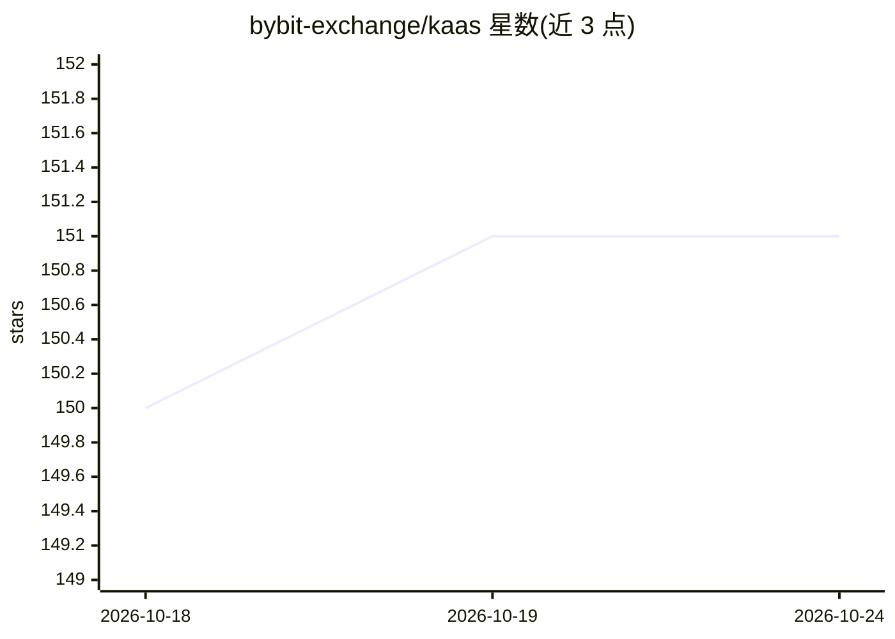

# bybit-exchange/kaas

⭐ 151 · Python · MIT · 推送 2026-09-11 · [GitHub](https://github.com/bybit-exchange/kaas) · [官网](https://bybit-exchange.github.io/kaas-doc/) · 组织维护 · 中文 README

**自托管个人知识库编译器：把散落笔记文档编译成可问答的 Markdown wiki**

由 Bybit 开源的知识库服务：将散落的笔记、文档、转录内容经四阶段 LLM 流水线（抽取概念/实体/决策→分类成文→撰写合并 Markdown→更新索引）编译为人类可读的 Markdown wiki 文章树，不做向量化嵌入；检索时 LLM 遍历主索引选取文章、以全文作答并附引用。提供 React Web UI、Go 后端与 Python AI 引擎打包的 Docker 镜像，通过 MCP 的 ask 工具供 Claude Code 等 agent 查询，支持任意 OpenAI 兼容 API。限制：默认超时参数按托管模型速度设定，本地小模型需调大配置。

## 筛选速览

| 维度 | 判定 | 备注 |
|---|---|---|
| AI 角色 | `ai-native` | 本体是模型或模型工具 |
| 许可风险 | `permissive` | MIT |
| 部署形态 | `self-host` | docker 或自建部署 |
| 模型依赖 | — | README 未给出锁定关系 |
| 硬件要求 | — | 无带数字的原话,不猜 |
| 安装摩擦 | `low` | 无编译、无系统依赖或容器化 |
| 成熟度 | — | 结构信号不足 |

## 能力要点

- 四阶段 LLM 编译流水线产出纯 Markdown 文章（无向量嵌入）
- 回答附带引用指向来源文章，流式 SSE 输出
- MCP 双传输（stdio/streamable-http），单一 ask 工具供编码 agent 查询
- 增量编译按内容校验和计费，任务租约与熔断机制处理失败

## 适用场景

- 把会议记录、邮件、文档沉淀为按角色组织的可查询 wiki
- 在 Claude Code 等编码 agent 中直接查询团队知识库
- 自托管替代向外部服务暴露内部文档的知识问答

## 场景标签

`知识库管理` `RAG` `文档问答` · 领域:知识与检索

## 证据(README 行号)

> L13: Turn scattered notes, documents, and transcripts into a searchable, queryable personal Wiki — powered by LLM-driven
> L37: Raw content passes through four LLM phases: extract concepts, entities and
> L148: |Retrieval|LLM iterative|master-index → LLM page selection → full-article context (no embeddings)|

## 星数曲线

2026-10-18 150 → 2026-10-24 151（+1）

---
*卡片 v1 · prompt 1.4 · 生成 2026-10-22 · 置信度 high · 依据 README sha `902cf1e20895` · [字段定义](../../DATASET.md)*
