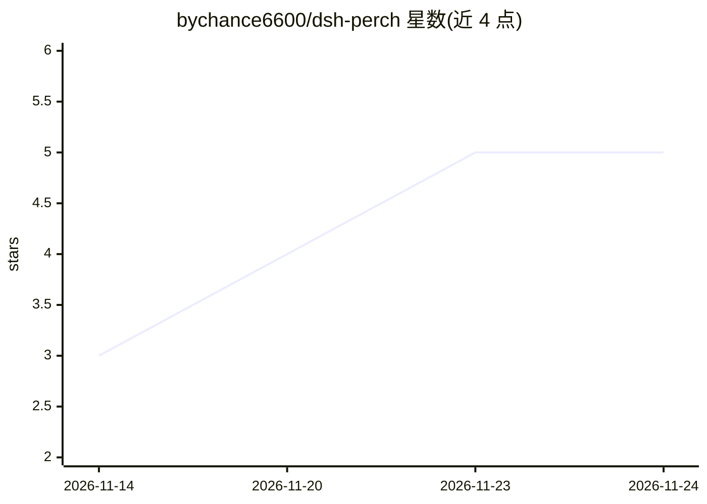

# bychance6600/dsh-perch

⭐ 5 · JavaScript · MIT · 推送 2026-11-23 · [GitHub](https://github.com/bychance6600/dsh-perch) · 个人维护 · 中文 README

**基于事件流长成人格的 DSH 插件，接 QQ 陪伴**

dsh-perch 是 DSH 的一个插件，提供一个通过只追加事件流（events.jsonl）逐步形成人格的陪伴角色：天、阶段、判断、疤、立场均从账本重放派生，不支持角色卡、性格滑条等直接设定，人格只能通过经历改变。她只在 DSH 会话与 QQ（OneBot 11 桥）两处说话，B 站与抖音是只读材料来源。要求 Node ≥ 22 与 DSH 0.2.x，零 npm 依赖，数据仅存本地 ~/.dsh-perch；记忆召回用词面/BM25/引用边，不用向量库。

## 筛选速览

| 维度 | 判定 | 备注 |
|---|---|---|
| AI 角色 | `ai-native` | 本体是模型或模型工具 |
| 许可风险 | `permissive` | MIT |
| 部署形态 | `desktop` | 安装包/桌面程序 |
| 模型依赖 | — | README 未给出锁定关系 |
| 硬件要求 | — | 无带数字的原话,不猜 |
| 安装摩擦 | `medium` | 含编译或系统依赖之一 |
| 成熟度 | — | 结构信号不足 |

## 能力要点

- 只追加事件流为唯一可信源，人格与记忆均由重放派生
- 四个阶段三道瓶颈的成长机制：需自己写过判断、拒绝过、改过口
- 三种翻旧事路径（字面/加权/顺线索），支持按人与时间段检索
- QQ 走 OneBot 11 客户端，支持群白名单、配额与冷却

## 适用场景

- 在 QQ 群或私聊里养一个长期演进的陪伴角色
- 观察事件流驱动的人格与记忆如何随时间变化
- 在本地离线运行、数据不外传的 AI 陪伴方案

## 场景标签

`聊天机器人` `Agent 记忆` · 领域:Agent 开发

## 证据(README 行号)

> L14: **她不是助手**：不接任务、不写周报、不排队等派活。也不是角色扮演——没有角色卡，没有「扮演一个…」。**人格不设配置菜单**：没有性格滑条，没有好感度数字，也没有「你是一个温柔的…」可以填。她是谁，只由她经历过的事决定——一条
> L76: - **两个房间**：DSH 会话，和 QQ（OneBot 11 桥）。B 站、抖音不是聊天的地方，是她看东西的地方：报纸端上来、自己搜、自己点开某一条。
> L287: - **没有向量库，也没有云端记忆服务**：召回靠词面、同义词与账本里的引用边，不调 embedding。

## 星数曲线

2026-11-14 3 → 2026-11-24 5（+2）

---
*卡片 v1 · prompt 1.4 · 生成 2026-11-21 · 置信度 high · 依据 README sha `003815f33fa3` · [字段定义](../../DATASET.md)*
