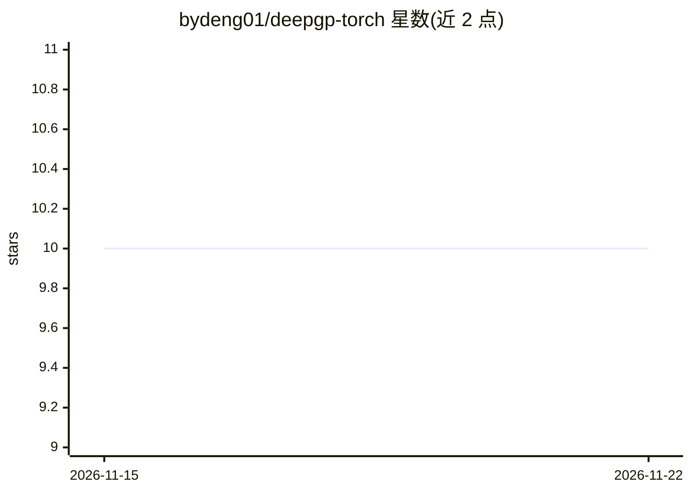

# bydeng01/deepgp-torch

⭐ 10 · Python · Apache-2.0 · 推送 2026-11-15 · [GitHub](https://github.com/bydeng01/deepgp-torch) · 个人维护

**面向科研的 GPyTorch 高斯过程回归库：ExactGP/SVGP/DeepGP**

基于 GPyTorch 的高斯过程回归 Python 库，提供 ExactGP（精确推断）、SVGP（带诱导点的稀疏变分 GP）和 DeepGP（双随机变分推断训练的深度 GP）三个模型，统一以 fit 训练、predict 输出预测均值与方差，支持多输出目标。API 遵循 GPflux，构建于 PyTorch、GPyTorch 与 linear_operator 之上。导入时将 torch 默认 dtype 设为 float64。当前处于早期开发，minibatch 训练与基准测试工具尚未实现。通过 PyPI 安装，要求 Python ≥3.10。

## 筛选速览

| 维度 | 判定 | 备注 |
|---|---|---|
| AI 角色 | `ai-native` | 本体是模型或模型工具 |
| 许可风险 | `permissive` | Apache-2.0 |
| 部署形态 | `library` | 以包/库形式分发 |
| 模型依赖 | — | README 未给出锁定关系 |
| 硬件要求 | — | 无带数字的原话,不猜 |
| 安装摩擦 | `low` | 无编译、无系统依赖或容器化 |
| 成熟度 | `idea` | |

## 能力要点

- ExactGP、SVGP、DeepGP 三种 GP 回归模型，fit/predict 统一接口
- DeepGP 构建器 build_deep_gp 自动初始化诱导点与变分分布
- 支持多输出目标 (N,T)，每输出独立 GP 与噪声方差
- predict 可选 add_noise=False 返回潜函数 f 的均值与方差

## 适用场景

- 对一维或多维数据做带不确定性的高斯过程回归
- 在大数据集上用 SVGP 稀疏变分方法拟合 GP
- 搭建深度高斯过程做函数回归实验

## 场景标签

 · 领域:机器学习/概率建模

## 证据(README 行号)

> L11: deepgp-torch is a GPyTorch library for Gaussian process (GP) regression. It
> L19: All three models are trained with `fit` and evaluated with `predict`. The
> L41: Requires Python ≥ 3.10, `torch>=2.0`, `gpytorch>=1.15`,

## 星数曲线

2026-11-15 10 → 2026-11-22 10（+0）

---
*卡片 v1 · prompt 1.4 · 生成 2026-11-19 · 置信度 high · 依据 README sha `43ab45fd59f3` · [字段定义](../../DATASET.md)*
