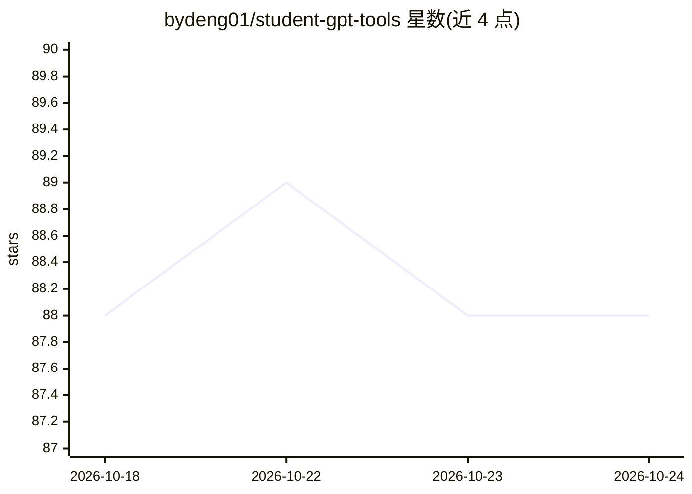

# bydeng01/student-gpt-tools

⭐ 88 · MIT · 推送 2026-10-22 · [GitHub](https://github.com/bydeng01/student-gpt-tools) · 个人维护 · 中文 README

**面向学生的 GPT/AI 工具策展清单（写作/学习/科研/编程）**

三语（英/中/印地）维护的 AI 工具与资源合辑，面向学生与研究人员，按写作与编辑、学习与备考、科研辅助、编程调试、创意与可视化、机构指南与负责任使用等类别组织。条目以表格呈现名称、费用与简介，收录 GPTs、商业工具与开源项目（含 GitHub 仓库链接），并建议用户选用 ChatGPT、Claude、Grok、Gemini 等最新模型，中文部分另列通义千问、DeepSeek、讯飞星火、文心一言。列表本身不含可安装的软件。

## 筛选速览

| 维度 | 判定 | 备注 |
|---|---|---|
| AI 角色 | `ai-knowledge` | 知识聚合/清单类 |
| 许可风险 | `permissive` | MIT |
| 部署形态 | `None` |  |
| 模型依赖 | — | README 未给出锁定关系 |
| 硬件要求 | — | 无带数字的原话,不猜 |
| 安装摩擦 | `low` | 无编译、无系统依赖或容器化 |
| 成熟度 | — | 结构信号不足 |

## 能力要点

- 按写作/学习/科研/编程/创意等类别组织的条目表格，标注费用与简介
- 收录 GPTs、商业工具与开源 GitHub 项目
- README 提供英/中/印地三语说明

## 适用场景

- 查找适合学术写作、语法润色与 AI 检测的工具
- 按学科找数学、语言学习与编程辅导类 GPTs
- 了解面向学生场景的 AI 工具与费用情况

## 场景标签

`精选清单` · 领域:学习与行业

## 证据(README 行号)

> L5: A curated collection of GPT tools and resources tailored for students to enhance learning, productivity, and creativ
> L40: ## Writing and Editing
> L55: |Name|Cost|Description|

## 星数曲线

2026-10-18 88 → 2026-10-24 88（+0）

---
*卡片 v1 · prompt 1.4 · 生成 2026-10-23 · 置信度 high · 依据 README sha `efdc8cd1d9f5` · [字段定义](../../DATASET.md)*
