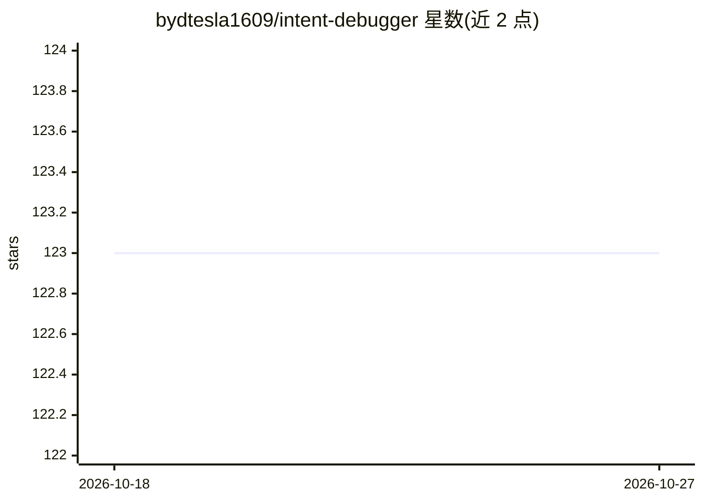

# bydtesla1609/intent-debugger

⭐ 123 · Python · MIT · 推送 2026-10-26 · [GitHub](https://github.com/bydtesla1609/intent-debugger) · 个人维护 · 中文 README

**需求澄清 Skill：把模糊想法整理成可核对的需求清单**

面向 Codex、Claude Code 与 DeepSeek 客户端的 SKILL.md 格式 Skill：用户以口语描述想法、场景、担心和例子，它整理成结构化需求清单，每轮包含需求梳理、问题澄清与当前共识三部分，并把合理推断标为暂定理解供用户核对；建立口语描述与专业术语的对应（如面包屑导航）。需求对齐后即结束，不进入规划或实现。三个平台共用同一份核心 Skill，DeepSeek 需将 SKILL.md 内容作为 system 消息发送。仓库带 evals 行为验收场景。

## 筛选速览

| 维度 | 判定 | 备注 |
|---|---|---|
| AI 角色 | `ai-ecosystem` | LLM/agent 周边工具 |
| 许可风险 | `permissive` | MIT |
| 部署形态 | `None` |  |
| 模型依赖 | — | README 未给出锁定关系 |
| 硬件要求 | — | 无带数字的原话,不猜 |
| 安装摩擦 | `low` | 无编译、无系统依赖或容器化 |
| 成熟度 | — | 结构信号不足 |

## 能力要点

- 每轮输出需求梳理、问题澄清、当前共识三部分并持续迭代
- 建立口语描述与专业术语的对应并继续确认边界细节
- 需求对齐后即结束，不自动转入规划、设计或实现
- Codex / Claude Code / DeepSeek 三平台共用同一份核心 Skill

## 适用场景

- 在让 AI 开工前先把模糊想法对齐成可核对的需求
- 不懂专业术语时让 AI 把口语描述映射为规范表述
- 逐项确认 AI 理解的需求是否与用户意图一致

## 场景标签

`提示工程` · 领域:Agent 开发

## 证据(README 行号)

> L72: 将 `skill/intent-debugger` 复制到 Codex 的个人 Skill 目录：
> L88: Claude Code 支持读取 `SKILL.md`。将 `skill/intent-debugger` 复制到以下任一位置：
> L97: DeepSeek API 没有相同的文件式 Skill 发现机制。使用 DeepSeek API 或支持 system prompt 的客户端时，将 `SKILL.md` 的完整内容作为首条 `system` 消息，再把具体想法作

## 星数曲线

2026-10-18 123 → 2026-10-27 123（+0）

---
*卡片 v1 · prompt 1.4 · 生成 2026-10-23 · 置信度 high · 依据 README sha `1ec15a74a552` · [字段定义](../../DATASET.md)*
