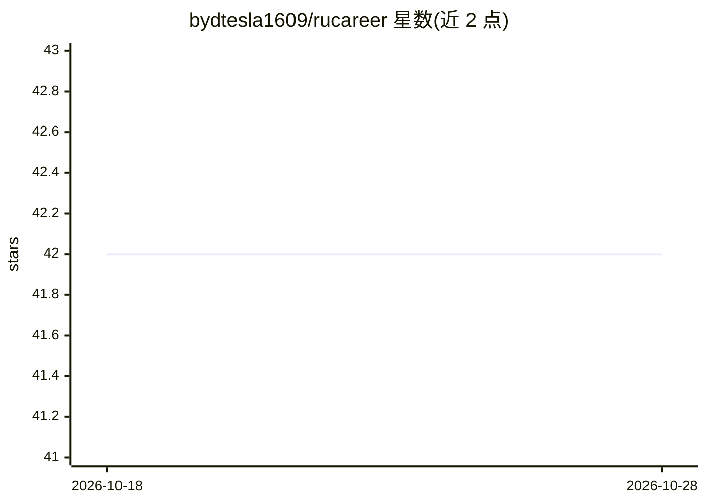

# bydtesla1609/rucareer

⭐ 42 · Python · 推送 2026-09-09 · [GitHub](https://github.com/bydtesla1609/rucareer) · 个人维护 · 中文 README

**面向大学生的本地经历档案与 AI 辅助简历生成桌面工具**

RUCareer（鹿路录）是 Windows 本地优先的个人经历管理工具：把基础信息、科创/实践经历、附件材料存入一个普通文件夹构成的“包装盒”，无需账号。用户自行配置 OpenAI 兼容 API 地址与密钥后，可由 AI 润色叙述、分析申请要求、初选经历并生成简历正文，导出 DOCX/PDF；提示词禁止虚构事实，AI 输出以可编辑草稿形式保存，需用户确认采用。未配置 AI 时本地编辑、基础简历与导出功能仍可用。API Key 不写入包装盒，可选 Windows DPAPI 加密保存。

## 筛选速览

| 维度 | 判定 | 备注 |
|---|---|---|
| AI 角色 | `ai-enhanced` | 去掉 AI 部分产品仍成立 |
| 许可风险 | `none` | — |
| 部署形态 | `desktop` | 安装包/桌面程序 |
| 模型依赖 | — | README 未给出锁定关系 |
| 硬件要求 | — | 无带数字的原话,不猜 |
| 安装摩擦 | `low` | 无编译、无系统依赖或容器化 |
| 成熟度 | `idea` | |

## 能力要点

- 经历与附件存入本地普通文件夹“包装盒”，无需注册账号
- AI 叙述/需求分析/简历生成走用户自配的 OpenAI 兼容服务，禁止虚构事实
- AI 输出保存为可编辑待采用草稿，确认后才替换原稿且先备份
- 每日自动备份保留 7 份、恢复创建新目录不覆盖数据

## 适用场景

- 我在申请岗位/研究生项目时整理自己的真实经历并生成针对性简历
- 我希望个人材料保存在本地、不上传云端账号
- 我需要 AI 帮我润色已有经历描述但不编造内容

## 场景标签

`AI 写作` · 领域:内容生成

## 证据(README 行号)

> L26: AI 功能使用您自行填写的 OpenAI 兼容服务和密钥。尚未配置时，本地编辑、附件、基础简历和导出可以正常使用。外部模板导入/解析属于 PRE 的后续阶段，本版提供五套内置模板。
> L122: 基础资料、经历管理、基础简历和文件导出都不依赖 AI。只有点击 AI 叙述、需求分析或 AI 生成简历时，相关文本与可读取附件内容才会发往用户配置的服务。

## 星数曲线

2026-10-18 42 → 2026-10-28 42（+0）

---
*卡片 v1 · prompt 1.4 · 生成 2026-10-25 · 置信度 mid · 依据 README sha `5bc0b0bab4a3` · [字段定义](../../DATASET.md)*
